# DailyCheck 技术架构

> **本文件是 Eric 拍板的硬性要求**：每次开发前必读，每次 commit 触及架构子系统时必同步。
> 门禁：`scripts/git-hooks/pre-commit`（已装）— 触及子系统但本文件未在同 commit 改动 → 拒绝。
> 辅助：`scripts/arch_touched_sections.py` — 基于 `git diff --cached` 提示需更新章节。
> 维护成本：< 5 分钟/次。**不维护的代价**：下一个开发者必然踩坑。

---

## 目录

1. [项目一句话](#1-项目一句话)
2. [系统拓扑（容器视角）](#2-系统拓扑容器视角)
3. [部署拓扑](#3-部署拓扑)
4. [数据架构](#4-数据架构)
5. [应用层模块图](#5-应用层模块图)
6. [蓝图依赖关系](#6-蓝图依赖关系)
7. [请求生命周期](#7-请求生命周期)
8. [鉴权架构](#8-鉴权架构)
9. [MCP 架构](#9-mcp-架构)
10. [业务领域模型](#10-业务领域模型)
11. [PWA / 移动端](#11-pwa--移动端)
12. [测试架构](#12-测试架构)
13. [关键约定与坑](#13-关键约定与坑)
14. [pre-existing 风险清单](#14-pre-existing-风险清单)
15. [文档索引](#15-文档索引)

---

## 1. 项目一句话

**单租户、多仓、带主数据治理的轻量库存管理系统，对 AI Agent 通过 MCP 协议开放 13 个工具。**

- **目标用户**：连锁餐饮/零售的小企业（5–50 仓规模），现场用手机做日常操作。
- **核心问题**：让一家公司能管 N 个门店/DCN/R&D 的库存，并让 AI Agent 读得到。
- **核心约束**：多租户 PoC 已落地（2026-10-10，轻方案：tenants 注册表 + 三表 tenant_id +
  请求级租户闸；canonical 扇出/订单/MCP 全链路租户化为 PoC 后续阶段）。

---

## 2. 系统拓扑（容器视角）

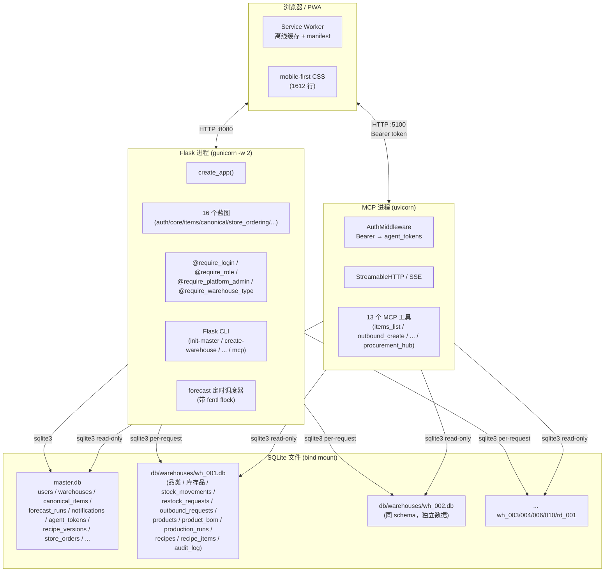

---

## 3. 部署拓扑

### 3.1 Dev 环境

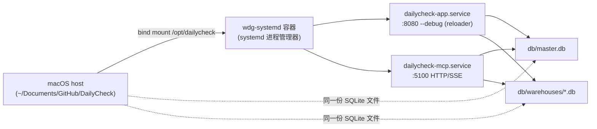

**关键**：bind mount 实时同步，**改 .py Flask 自动 reload**，**MCP 进程无 reloader**，改 `mcp_server/*.py` 必须手工 `systemctl restart dailycheck-mcp`。

### 3.2 Prod 环境

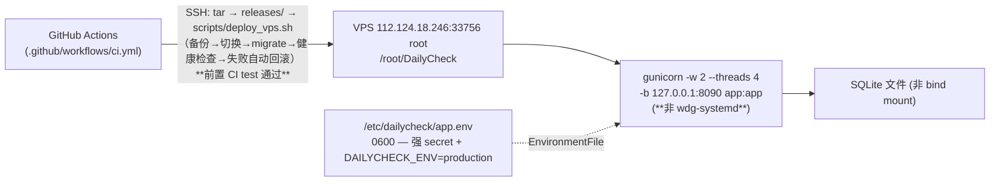

### 3.3 ⚠️ 部署重大差异（必读）

| 维度 | Dev | Prod |
|------|-----|------|
| **时区** | UTC | **Asia/Shanghai (CST+8)**，unit 未设 TZ |
| **数据库路径** | bind mount（容器/host 同一文件） | 本地文件系统 |
| **进程管理器** | systemd in container | gunicorn -D（无 systemd） |
| **Flask reload** | `--debug` 自动 reload | 无 |
| **MCP 进程** | systemd unit | **未部署**（MCP 只在 dev 跑） |
| **部署方式** | mount + edit | `ci.yml` test 通过后走 `scripts/deploy_vps.sh`：sqlite 热备全库 + 代码备份 → rsync 切换（`*.db`/log/venv 永不触碰）→ `flask migrate up` → systemd 重启 → `/health` 探活 → 失败自动回滚代码并重启。**db/ Python 包必须进代码备份**（2026-10-10 dev 演练踩坑） |
| **备份/DR** | 无 | `scripts/backup_all.sh`（cron 每日，integrity_check + tar + 可选异地）+ `scripts/verify_restore.sh`（每周还原演练）+ `docs/runbook-dr.md`（RPO=24h/RTO=1h） |
| **入口端口** | :8080 / :5100 | :8090（仅 Flask） |

### 3.4 蓝绿部署（Phase 1 实装，2026-10-13 起）

Prod 专用（dev 不涉及）。`scripts/blue_green/` 6 脚本：`up.sh`（起绿：DB `cp -a` + systemd **restart** + 30×2s 健康检查，**重启前先判绿是否在承流**，在役则先切蓝；**并把 unit 复位成静息态**——`DRY_RUN=true` + 副本库）→ `verify.sh`（八项生产验证，报告落 `backups/prod-verifications/`）→ `promote.sh`（**绿转正**：关 `DRY_RUN` + DB 指回真库 + daemon-reload/restart + 健康复核，幂等 + 备份 + 失败回滚）→ `switch.sh`（nginx upstream weight/down 切流量，`nginx -t` 验证 + 失败自动还原备份）→ `rollback.sh`（秒级切回蓝 + journalctl/DB 取证）→ `down.sh`（绿下线，`--keep-blue` 保留 DB 7 天）。端口：蓝 :8090/:5100，绿 :8091/:5101。全脚本支持 `--dry-run`（只回显不执行）。**完整时序**：up（复位静息态 → 重启为 `DRY_RUN=true` + 副本库）→ verify → promote → switch（5/50/100）。

**铁律**：
- **nginx 备份绝不写 `sites-enabled/`** —— 主配置 `include sites-enabled/*` 会把 `.bak` 当配置加载 → duplicate upstream 永久 fail（Issue #24 Bug A）。统一落 `BACKUP_DIR`（默认 `/var/lib/dailycheck-blue-green-backups/`）。
- **`verify.sh` 禁用 `set -e`** —— check 失败由 `OVERALL_PASS` 跟踪，`trap _write_report EXIT` 兜底保证任何失败路径都写报告（Issue #24 Bug B）。
- **check 1 禁止兜底** —— 真跑 pytest（`-rf` 产出 FAILED 行）+ 复用 `scripts/check_known_failures.py` 判「失败集 ⊆ known_failures.txt」，不允许把失败兜成 PASS。
- **check 2 禁止静默跳过** —— `scripts/playwright/sim_user.py`（纯 stdlib）真走 登录→选仓→总览→库存→健康报表 5 路径（含 CSRF 回填）；凭据走 `SIM_USER_USER` / `SIM_USER_PASSWORD` 环境变量，缺失直接 FAIL。末条 `/report/health`（Issue #38 补）需 **manager+ 账号**（平台 admin 放行），403 按失败处理不降级；同时校验落点须停在 `/report/health`——会话丢失会 302 到 `/login` 再返回 200，只看 status 会假绿。
- **check 2 凭据必须 provision 进「绿」库（Issue #34）** —— sim_user 的 HTTP 凭据校验发生在**绿进程持有的库**上，而 verify.sh 跑的 wrapper shell 不在绿 unit 环境里。因此 `_ensure_sim_user_in_green_db()` 必须用**显式 `DAILYCHECK_DB_DIR=${GREEN_DB}` 覆盖**（子 shell 内赋值，禁止继承调用者环境）幂等 ensure 账号，且必须带 **`--admin`**（非 admin 用户在选仓页只看到 `warehouse_users` 绑定的仓，而 create-user 不写绑定 → 空选仓页 → 探针路径 3 必失败）；探针前再复核「绿库有该账号 + 密码匹配 + 未停用（`is_active`）+ 有可见仓」（覆盖 up.sh 快照里同名不同密码 / 已停用 / 非 admin 账号的情形），并在**写库之前**先用「路径形态 + inode 相异」双闸自证 `${GREEN_DB}` 不是蓝库（check 7 排在 check 2 之后，误配时否则会先把一个已知口令的 admin 写进 production 真库）。**裸跑 `flask create-user` 会写蓝库（production 真库）** —— 绿库查无此人导致路径 2 恒 401，实测见 Issue #34；任何新增的「verify 里要碰 DB 的步骤」都必须照此 pin env 到目标侧库。
- **DB 隔离（Issue #28）** —— 蓝绿不许共享物理库：`config.py` 在 import 期读 `DAILYCHECK_DB_DIR` env（Flask 与 MCP 同源覆盖）；`up.sh` 从真库 `${APP_DIR}/db` 用 `cp -aL` 解软链拷独立副本，且守卫绿 unit 必须声明 `DAILYCHECK_DB_DIR` 与拷贝目标一致，否则拒启；`verify.sh` check 7 取三重证据（绿进程 environ 声明 + master.db 非软链 + 蓝/绿 inode 相异）。**改部署布局（软链/数据目录迁移）必须保持这三个语义**。**语义边界（勿与「绿转正」冲突）**：本条约束的是**验证期**（绿以 `DRY_RUN=true` 承接 0 流量）；一旦按下方 DRY_RUN 铁律走「绿转正」承接生产流量，绿必须把 `DAILYCHECK_DB_DIR` 改指生产真库 `${APP_DIR}/db` —— 转正后蓝绿同库是**设计预期**（单写者：蓝 standby 不写），此时 check 7 的「inode 相异」不再适用，写安全改由 DRY_RUN 守卫保证；转正后重跑 `verify.sh` 若 check 7 报红，属预期而非回归。**同源影响 check 2**：`_ensure_sim_user_in_green_db()` 之所以能靠「路径形态 + inode 相异」双闸拒绝写蓝库，前提同样是验证期的库隔离；转正后该前提消失（`GREEN_DB` 变量值仍在、实际库已是真库，双闸退化为假保证）。因此**转正后如需复跑 `verify.sh`，应先在蓝绿框架下回蓝（`switch.sh blue 100`）并恢复验证期布局**，或在明确「已知同库」的前提下判读 check 2 / check 7 的红。
- **nginx 单 upstream 蓝绿同池（Issue #32）** —— `location` 的 `proxy_pass` 永远指向合并的 `dailycheck` / `dailycheck-mcp` upstream，蓝绿是同 upstream 内的两个 `server` 节点；切流量只改 server 行的 `weight=N` / `down` —— **switch.sh 不动 location 也不新增 `dailycheck-blue/green` upstream**（旧布局下 location 硬编码，upstream 切了真实流量不动 → 502 必现，Issue #32 实测）。三道防线：① `switch.sh` 头部布局守卫 grep `proxy_pass http://dailycheck-(blue|green)` 命中旧布局直接拒跑（exit 2），强制 Prod Agent 先按 `scripts/blue_green/nginx-site.conf` 模板重构；② `switch.sh` 尾部 post-switch 探活，过 nginx 入口（默认 `http://127.0.0.1:8080`，可用 `NGINX_ENTRY` 环境变量覆盖，dry-run 路径也透传）取 `http_code`，5xx/000 自动 cp 备份回滚 + reload；③ `verify.sh` check 8 终态保险，再过一遍入口探活捕获 reload → observe window 期间的状态漂移。**改 nginx 布局必须保持单 upstream 模型**，新增独立 upstream 必须同时承担布局守卫与探活的改造。
- **DRY_RUN 实例绝不承接流量（Issue #41，2026-10-15 P0 事故）** —— 绿实例的 `DRY_RUN=true` 写隔离只允许存在于验证期：窗口期曾发生「绿实例接管生产流量 44 分钟、全部写操作被吞」（HTTP 200 / 审计照记 / DB 不落盘）。`switch.sh` 四道防线：① **DRY_RUN 守卫** —— 切换后凡承接流量（weight>0）的实例检测到 `DRY_RUN=true`（取证次序：进程 `/proc/<pid>/environ` → unit `systemctl show Environment`；无法判定仅告警）即拒跑（exit 3），必须先按 README「绿转正」（关 DRY_RUN + DB 指回真库 + restart）再切；② **conf 应用核验** —— sed 后逐行核对 4 条 server 行与期望一致（sed 未命中时 `nginx -t` 仍过、reload 仍「成功」而权重根本没变，静默失败）；③ **reload 失败显式回滚**（旧版 `set -e` 直退会留下 conf/运行态分歧）；④ **落点核验** —— 100%/0% 边界用带 nonce 的探针核对流量真实落到目标实例 access log（**全部尝试**均未命中目标且至少一次落对侧=回滚；日志不可读=仅告警）；**探针必须重发（Issue #55）**：nginx worker 在 `reload` 后需 1-3 秒才刷新 in-memory upstream，只发一次探针必然落在旧配置（对侧），「反复 grep 同一个 nonce」等不来路由改变 → 必然误判「reload 未生效」并自动回滚（2026-10-16 生产实测：`switch.sh green 100` 被误判失败，部署只能人工 `sleep 3` 绕过）。现为「每次尝试用**新 nonce** 重发探针 + 轮询日志」，命中目标 access log 即成功（默认最多 `LAND_TRY_MAX=5` 次、每次轮询 4×0.25s、尝试间等 1 秒 ≈ 常态等待预算 10 秒；探针自身 `--max-time 5`，入口持续无响应的最坏耗时可到约 35 秒）；对侧命中不再一票判死（那是 race 的正常表现），只有「所有尝试均未命中目标且至少一次落对侧」才认定 reload 真的没生效 → 回滚；若最终命中而此前有探针落过对侧，成功信息会额外回显一行说明，避免运维把刷新窗口当故障。`LAND_TRY_MAX < 2` 会打 WARNING（等于退回 #55 的只发一次，仅供调试）。节奏参数 `LAND_TRY_MAX` / `LAND_POLL_MAX` / `LAND_POLL_STEP` / `LAND_RETRY_SLEEP` 可 env 覆盖（测试用 0 秒只跑行为断言）。**「绿转正」标准步骤见 `scripts/blue_green/README.md`**。
- 端口 0 权重不被 nginx 1.24 接受，用 `down` 关键字标记不参与负载。
- **活流量守卫：绿在役时 up.sh 必须先切蓝（Issue #81，2026-10-17 P0 事故）** —— `up.sh` 在 restart 绿之前解析 nginx conf（`NGINX_CONF`，默认 `/etc/nginx/sites-enabled/dailycheck`）：`server 127.0.0.1:8091` 非 `down` 且 `weight>0` = 绿在承流 → **先探活蓝**（`BLUE_HEALTH_URL`，默认 `http://127.0.0.1:8090/health` 须 200），健康则 `switch.sh blue 100` 把流量挪走，再继续重启绿；蓝不健康 → 报错 exit 1 且**绝不重启在役的绿**。绿不承流（`down` / `weight=0` / 不在 upstream）行为与加固前一致。**conf 读不到 / 无 `upstream dailycheck` 块 / `weight` 值不可解析 → 一律 exit 1 拒绝执行**（此刻无法判断重启会不会打断在役实例，静默放行等于赌运气）。时机关卡位置：守卫必须在「拷 DB / 重启 unit」**之前**——一旦开动，绿的在役状态已被破坏，再想先切蓝已无处可退。事故形态即「绿承接 100% 流量时原地 restart 绿」→ 全站 502 +（unit 仍带 `DRY_RUN` 时）把线上实例换回「写隔离 + 副本库」→ 写操作静默假成功；`switch.sh` 的 DRY_RUN 守卫只挡「切换动作」，挡不住这条路径。
- **转正必须是可重放脚本，不能只是 README 步骤（Issue #81）** —— `promote.sh` 固化「关 `DRY_RUN` + DB 指回真库 + `daemon-reload` + restart + 健康复核」，语义与 README「绿转正」段一一对应：unit（及存在的 `GREEN_ENV_FILE` / `GREEN_MCP_ENV_FILE`）的 `DRY_RUN=true→false`（**无该行则不加**）、`DAILYCHECK_DB_DIR=*` → `${APP_DIR}/db`；改前备份到 `BACKUP_DIR`（清单化，供恢复）、改后**复验**（sed 未命中 = 静默失败，必须显式拦下）；任一步失败 → 按清单恢复 + `daemon-reload` + exit 1；**已转正 → 打印 `already promoted` 并 exit 0，绝不重复 restart 在役实例**（重启在役实例就是事故本身）；沿用部署锁门禁（无锁 exit 10，`DAILYCHECK_DEPLOY_UNLOCKED=1` 逃生）。退出码：0 成功/已转正、1 失败（已回滚）、10 无锁、64 参数错。
- **静息态复位是 up.sh 的职责，且只能在「流量已离开绿」之后做（Issue #28 闭环）** —— `promote.sh` 转正会把绿 unit 改成「真实态」（`DRY_RUN=false` + DB 指回 `${APP_DIR}/db`），而生产当前绿就是转正态；若 `up.sh` 不复位，下一轮部署要么被隔离守卫 `exit 1` 拒启（fail-closed 停摆），要么让绿以**真实写能力**跑副本库（写进将被丢弃的库）。故 `up.sh` 步骤 3.0 负责把 app unit 的 `DRY_RUN` 置 `true`、两个 unit 的 `DAILYCHECK_DB_DIR` 指 `${GREEN_DB}`（缺行则插入 `[Service]` 段首——转正侧「无该行则不加」、复位侧「必须保证在」，两边刻意相反），env 文件（`GREEN_ENV_FILE`）里的 `DRY_RUN=false` 一并改（systemd 语义：`EnvironmentFile` 覆盖 unit 的 `Environment=`；同理 `promote.sh` 转正时也一并改）。**三条安全边界**：① 复位必须排在 2.5 活流量守卫**之后**——绿在承流时改 unit，任何一次 restart（本脚本 / 别的会话 / systemd `Restart=always`）都会把在役实例变成写隔离；② 复位 → 断言 → `daemon-reload` → restart 之间不插入别的动作，把「文件≠运行态」的窗口压到最短；③ **绝不**在 `switch.sh green` 成功后把 unit 改回 `DRY_RUN=true`——复位只在 `up.sh` 开头做（`promote.sh` 是反向的唯一入口）。幂等：已静息 → 打印 `already resting`，**不写文件、不 daemon-reload**。改写用「awk → 临时文件 → mv」（跳过整行注释；`sed -i` 与 sed 的 `a\` 插入命令 GNU/BSD 语法不同，均为不可移植陷阱），改完**复验**（awk 未命中 = 静默失败）+ step 3.5 三层取证（文件生效行 / `systemctl show -p Environment`（抓 drop-in 覆盖）/ unit 必须声明 DB），任一不通过 → 按 `BACKUP_DIR` 清单恢复 + `daemon-reload` + exit 1 且**不重启绿**。注意 3.5 **不**看 `/proc/<pid>/environ`：此刻还没 restart，进程环境是上一轮转正的事实。
- **起绿必须 `systemctl restart`（Issue #38）** —— `up.sh` 步骤 4 对绿 Flask / MCP 两个 unit 一律 `restart`（未跑则起、在跑则重启）：`start` 对**已在运行**的 unit 是 no-op，而步骤 3 已把新 DB 拷进绿库 → 变成「新 DB + 旧代码」，verify / switch 判定的对象一半新一半旧。两处 restart 必须带 `|| true`（`set -euo pipefail` 直退会跳过步骤 7 的 journalctl + DB 取证，失败现场就丢了），失败交给步骤 5/6 健康检查判红；另须在 restart 前回显 `systemctl is-active` 的 pre-state（「新库 + 旧码」只有对照 pre-state 才看得出），该回显要绑到 live 分支的命令本体而不是 dry-run 的 echo 文案。改 up.sh 启动段必须同时保住这四个语义（restart / `|| true` / 取证可达 / pre-state 真实查询）。
- 单测：`tests/test_blue_green_implementation.py`（80 用例，bash -n / dry-run 回显 / 参数解析 / 关键不变量 / sim_user 假服务器全流程（含 Issue #38 路径 5：500 拦截 / 403 提示 / 落点校验防假绿）/ 绿库账号 provision（Issue #34：env pin 覆盖语义 + `--admin` + 可见仓/停用/密码三条复核 + 写库前「拒绝写蓝库」双闸（路径形态 + inode），函数按标记抽取真跑）/ config env 覆盖；关键断言逐条经变异验证）。**夹具凭据一律不写字面量**：口令用 `secrets.token_hex()` 运行期生成（`_SIM_PW` / `_OTHER_PW`）——`password="<字面量>"` 会被 GitGuardian 的 Generic Password 规则判为泄露、直接把 PR 检查打红，而断言从不依赖取值。另有 `tests/test_blue_green_dryrun_guard.py`（13 用例：DRY_RUN 守卫拦截/放行/无法判定三态、conf 应用核验、落点核验（命中/对侧回滚/不可读告警/**reload race 重发重试（Issue #55：第 1 次探针落对侧 → 重发后命中，不误回滚；绿/蓝两个方向）+ 重发默认预算静态钉死**）、灰度跳过；live 全流程跑 switch.sh，PATH 前置 fake systemctl/nginx + 本地假入口服务器（假服务器可按探针**次数**分别落目标侧/对侧，用于复现 worker 刷新窗口）；关键断言逐条经变异验证）。两文件合计 93 用例（80 + 13）。另有 `tests/test_blue_green_promote_guard.py`（25 用例：`promote.sh` 的 dry-run 无副作用 / 正常转正（含 unit DB 值**带引号**形态）/ 幂等不重复 restart / 锁门禁与 `DAILYCHECK_DEPLOY_UNLOCKED` 逃生 / 健康失败与 restart 失败各自回滚恢复 / env 文件里的 DRY_RUN 覆盖也一并转正 + `up.sh` 活流量守卫的 绿在役先切蓝（**调用顺序**断言）/ 蓝不健康拒跑 / conf 解析失败与缺失拒跑 / 绿不承流行为不变 / 切蓝失败阻断重启 + `up.sh` **静息态复位**的 已转正态被复位（**切蓝之后、restart 之前**，用 fake `switch.sh` 的「切流量瞬间 unit 快照」硬断言）/ 缺行插入 `[Service]` 段 / 幂等（文件与 mtime 不变、零 daemon-reload）/ dry-run 零副作用 / drop-in 仍覆盖成 `DRY_RUN=false` 时 fail-closed 且不重启绿 / 注释行不被改写 / env 文件覆盖一起复位；fake systemctl/curl/ss/switch + tmp unit，macOS 与 Linux 同解；关键断言经变异验证 —— 去掉 `switch.sh` 调用、短路复位分支、把复位挪到切流量之前，三者各自打红对应用例）。
- **协作流程与门禁**：Dev 提 PR 必含「生产侧事项」段（`check_reports.py` 强制，缺失即红），只写规范流程粒度不写操作脚本；**merge 由 Prod Agent 判定执行**（CI 全绿 + 独立审查，异议打回），红线清单见 `docs/agent-framework/workflow.md` §四。

### 3.5 PR Webhook 接收器（2026-10-15 实装）

Dev Agent 提完 PR 后，**GitHub repo → webhook → VPS `dc-webhook-receiver` → `inbox.jsonl` → `dc-inbox-watcher`（≤5s 触发）→ Prod Agent 入口 → 跑 merge 决策**。秒级通知，替代 30 分钟轮询。

**组件**（`scripts/blue_green/webhook_receiver.py`，Flask 127.0.0.1:8443）：
- **HMAC-SHA256 验签**（`X-Hub-Signature-256` + `WEBHOOK_SECRET` env）—— 拒伪 + 拒重放，constant-time 防时序攻击
- **事件过滤**：`pull_request`（action 仅 `{opened, synchronize, reopened}`，`closed` / `edited` / `labeled` 等跳过）+ `check_suite`（action 仅 `completed`，且仅「有 PR 关联 + conclusion=success」落盘 —— CI 全绿秒级唤醒快通道，2026-10-16 增）
- **幂等**：按 `X-GitHub-Delivery` 去重（GitHub 会重试 6 次，receiver 必须幂等否则 inbox 写脏）
- **反压**：`inbox_size ≥ MAX_INBOX_LINES`（默认 1000）返回 503，GitHub 暂停重试（指数退避 1s/2s/.../1h）
- **inbox 落盘**：每行 JSON，append-only，含 `delivery_id / event / action / pr_number / pr_title / pr_head_sha / pr_base_ref / pr_author / repo_full_name / received_at_ms`；`check_suite` 记录追加 `check_conclusion / check_head_branch / check_suite_id`（payload 没有的字段如 pr_title / pr_author 填空串，字段形状与 pull_request 记录对齐）

**部署**（owner / Prod Agent 手动，不进 Dev 自动化）：
- **前置：443 入站必须放行**（2026-10-16 实测踩坑）——残留 ufw 链 + `INPUT` policy DROP 布局下，`ufw-user-input` 须含 `tcp dpt:443 ACCEPT` 且 `/etc/iptables/rules.v4` 同步补行；**本机 `curl` 走 `lo` 接口被直通——200 不能证明外网可达**，必须外部 vantage 复验（详见手册 §2/§4）
- DNS：`hook.kjtang.cn` A 记录 → 112.124.18.246（与主站同 IP）
- 证书：hook **独立**阿里云免费 DV 证书（单域名，`/etc/nginx/ssl/hook.kjtang.cn.{pem,key}`，90 天轮换）——免费证书不能给主证书加 SAN，主站证书不动
- systemd：`deploy/systemd/dc-webhook-receiver.service`（监听 127.0.0.1:8443，单 worker，gunicorn，Restart=always 5s）
- nginx：`deploy/nginx/hook.kjtang.cn.conf` 部署为**独立文件** `/etc/nginx/sites-enabled/hook.kjtang.cn`（与蓝绿 `switch.sh` 解耦：布局守卫只检查 dailycheck 文件；443 TLS 终结 + proxy_pass，limit_req 30r/s 防滥刷；`limit_req_zone` 只能放 http 上下文，勿放 `server{}` 内）
- WEBHOOK_SECRET：32 字节强密码，写 `/etc/dailycheck/webhook-secret`（600 root），**不出现 git 仓库 / 文档 / prompt**（仅 systemd unit `EnvironmentFile=` 引用 + GitHub repo webhook 设置）
- GitHub repo：Settings → Webhooks → Add，URL `https://hook.kjtang.cn/webhook`，Secret 同上，Events 勾 **"Pull requests" + "Check suites"**（后者 = CI 完成快通道，2026-10-16 增）

**生产侧操作手册**：`docs/2026-10-15-webhook-setup.md`（50-70 分钟手动部署；DNS / **443 放行核验** / 申请 hook 独立证书 / systemd / nginx reload / GitHub 配 webhook + 端到端验证）。

**测试**：`tests/test_webhook_receiver.py`（19 用例：HMAC 三态 / event 过滤 / action 白名单 / 幂等 / 反压 / inbox 字段完整性 / `/health` 端点 / check_suite 六态（success 落盘 + check_* 字段 / 非 success 拒绝 / 无 PR 拒绝 / 非 completed 拒绝 / action 白名单分叉 / 幂等）；全部经变异验证真 FAIL —— 删 HMAC 验签 / 删反压 / 删幂等 / 删 conclusion 过滤 / 删 no_pr 过滤 / 白名单误加 opened 各自对应测试 FAIL）。

**Prod Agent 集成（2026-10-16 实装，Issue #47）**：`scripts/prod_agent/inbox_watcher.py` 常驻订阅 `inbox.jsonl`，新条目 **≤5s** 内触发 `--trigger-cmd`（事件 JSON 原样走 stdin；样例 `deploy/scripts/dc-notify-prod-agent.sh` 把事件投给 Prod Agent 入口，默认指向 Hermes webhook 订阅）。要点：

- **tail 语义**（纯 stdlib、跨平台）：轮询 `stat(inode, size, mtime)` 检测变更（默认 0.5s 间隔），只处理以 `\n` 结尾的完整行（半行留待下轮）——不用 inotify（Linux-only）、不引三方库
- **去重语义**：全文件扫描 + `handled_ids` 状态集合（原子写 `inbox_watcher_state.json`）—— 重启 / rotate 换 inode / 停机期间新增等任何时序下，每条 `delivery_id` 至多触发一次、未触发过的必然补触发
- **机械过滤**（纵深防御）：仅 `repo_full_name == ericmr1981/DailyCheck` 且 action 属白名单（unit 显式传 `--actions opened,synchronize,reopened,completed`，`completed` 供 check_suite 事件使用）的条目触发；draft 等业务语义交 Prod Agent 判定，本脚本不预判
- **失败重试**：触发非 0 退出 / 超时 → 指数退避（1s→60s 封顶）+ WARNING 留痕，绝不静默丢弃。退避到期**不再依赖 inbox 文件签名变化**（Issue #51 修复）：主循环条件为 `sig != last_sig or retry_due(state)`，inbox 无新行时退避条目也会自行重试；`retry_due` / `_next_at` 与 `load()` 归一化共用 `state.sane_ahead` 上界（= `retry_max + 300s` 时钟余量）。下方兜底轮询继续保底
- **兜底轮询（2026-10-16 实装，§3.9）**：Prod 侧 Hermes cron 每 30 分钟跑 `dailycheck_pr_poll.py`（repo 同源 `deploy/scripts/`）直接查 `gh pr list --state open`——webhook 快通道整体故障时的保底发现通道；无 open PR 零 stdout（agent 回 `[SILENT]` 无投递），有 PR 走同一 `dailycheck-prod-agent` skill 判定
- **CI 完成快通道（2026-10-16 增）**：`check_suite`（CI 全绿）事件走同一 inbox → watcher 链路，`dc-notify-prod-agent.sh` 按事件类型路由订阅（check_suite → `dailycheck-ci`，其余 → `dailycheck-pr`）——CI 一绿即触发 Prod Agent 判定 merge（此前 merge 环节需等兜底轮询接棒，最坏 ≤30 分钟）。中间态（suite 绿但两必需 check 未齐）由 Prod Agent 回 `[SILENT]` 抑制投递。⚠️ webhook 通道的 `[SILENT]` 抑制 = gateway `gateway/platforms/webhook.py` 的**本地补丁**（上游出厂仅 cron 投递支持），Hermes 重装/升级后需重打，见手册 §3.8 步骤 3.5
- **归档（防反压挂死）**：`scripts/prod_agent/inbox_rotate.py` + 每日 timer 把 >7 天旧行迁到 `inbox.archive.jsonl`（rename+重建+收敛回填，与 receiver 并发不丢行）—— inbox 是反压闸门（≥1000 行 receiver 返 503），只增不减会挂死新通知
- **部署**：`deploy/systemd/dc-inbox-watcher.service`（Restart=always / 5s）+ `dc-inbox-rotate.{service,timer}`（每日 00:30）。⚠️ 两个要点（2026-10-16 实测）：unit 的 `ProtectHome` 必须 ≤ `read-only`（`=true` 屏蔽整个 `/root` → `203/EXEC` 无限重启）；触发命令走 Hermes 时必须用 venv 绝对路径 `/root/hermes-agent/.venv/bin/hermes`（`#!/usr/bin/env python3` wrapper 在 watcher 的 PATH 下会解析到 DailyCheck venv，缺 yaml）。手册见 `docs/2026-10-15-webhook-setup.md` §3.8/§3.9
- **测试**：`tests/test_inbox_watcher.py`（**84 用例**：完整行/半行/U+2028 不误切 / 过滤 / 去重（重启不重复、停机补触发）/ 失败退避 / rotate 七态 / 真实子进程 ≤5s 端到端 / 确定性「旧 fd 窗口」收敛回填 / **json 层损坏不崩（4301 位整数 / 非 UTF-8 字节 / 超深嵌套）** / **代理字符键与代理字符 inbox 值均不崩** / **inbox 行解析三形态不崩** / **孤立代理字符 delivery_id 按坏行处理** / **退化退避到期后无新行自动重试（端到端）** / **8 类条目级 + 3 类容器级损坏归一化与 WARNING 留痕** / **`next=1e308` 不再永久锁死** / **天文位数 attempts 不挂死** / **prune 排除已 handled 的失败残留（否则 retry_due 恒 True → 主循环空转）**；关键断言经变异验证真 FAIL —— 删去重 / 删半行等待 / 失败走成功分支 / 删尾部回填 / 边界反转 / 回退日志转义 / 回退 gating / 回退归一化 / 回退 ldexp 各自对应测试 FAIL）

- **输入层损坏不崩（Issue #66 审核 H-1 / M-3 / L-6，2026-10-17 加固）**：① `WatcherState.load()` 的异常网从 `(OSError, json.JSONDecodeError)` 放宽为 `(OSError, ValueError, RecursionError)` —— 覆盖非 UTF-8 状态文件的 `UnicodeDecodeError`、`json.loads` 对 **>4300 位整数字面量**抛的 ValueError（`sys.get_int_max_str_digits()` 默认 4300，比 `float()` 的 309 位阈值更早触发）、超深嵌套 JSON 的 `RecursionError`；修复前三者直穿 `main()` → `Restart=always` 崩溃循环。② `_parse_record()` 的异常网同样放宽为 `(ValueError, RecursionError)` —— 单条含 >4300 位整数 / 超深嵌套的 inbox 行此前会让 `process_once` 抛出并**反复崩在同一行**（该行永远进不了 `bad_hashes`，故永不跳过）。③ `_delivery_id()` 拒绝**无法 UTF-8 编码**的 id（inbox 行里 `"\ud800"` 这类孤立代理字符能被 `json.loads` 解出，但 `print` / 状态写盘都会抛 `UnicodeEncodeError`）→ 按坏行处理（指纹去重 + `!r` 转义打印）。三处均与孪生副本 `deploy/scripts/dailycheck_dashboard_on_pr.py` 同口径；同 PR 另修两条同型缺陷：① 两侧 `action` 为 list / dict 等**不可哈希**值时 `x in frozenset` 抛 TypeError → 崩溃循环（M-1-r4，先判 `isinstance(action, str)`）；② `triggered:` 日志的 `pr_number` / `pr_head_sha` 未转义 → 代理字符值崩溃循环（H-1-r3，统一过 `_short()`）。`tests/test_inbox_watcher.py` 在同 PR 内由 38 用例扩至 84

### 3.6 项目任务 Dashboard 自动生成（2026-10-16 起）

**目标**：每次 PR webhook 触发时，自动拉 gh + git 状态渲染 `dashboard.html` + 落 SQLite 快照到历史库——替代之前的"手写一次 / 不动"快照，让状态有真正的"上次 vs 现在"差。

**组件**：
- **核心包** `scripts/dailycheck_dashboard/`（dev 端，可 commit）：
  - `__main__.py`：CLI 三子命令 — `render`（拉数据 + 渲染 + 落 db）/ `history`（列最近 N 快照）/ `diff`（最近两次 KPI 对比）
  - `db.py`：SQLite 封装（`snapshots` 主表 + `issues_snapshot` / `prs_snapshot` / `worktrees_snapshot` 三个子表 + `schema_version` 幂等迁移；autocommit 模式 + WAL + `synchronous=NORMAL`）
  - `fetchers.py`：gh CLI 包装（`issue list --state all --json` / `pr list --state all --json`，字段驼峰→snake_case 规范化）+ git worktree 解析（porcelain 格式）+ inbox 统计
  - `render.py`：HTML 渲染（`string.Template` 内嵌 CSS，零三方依赖，KPI 卡片差异行用 `↑N` / `↓N` / `→` 三态箭头）
  - **零外部依赖**：纯 stdlib（`sqlite3` / `subprocess` / `json` / `pathlib` / `string.Template`）
- **触发 listener** `deploy/scripts/dailycheck_dashboard_on_pr.py`（VPS 端，systemd 拉起）：订阅 `inbox.jsonl`，收到 PR 事件（`{opened,synchronize,reopened}`）→ 调 `python -m scripts.dailycheck_dashboard render --trigger-kind pr_xxx --trigger-event-id <delivery_id>`。**与 `dc-inbox-watcher` 完全独立、互不干扰**（各自一份 handled_ids state-file；同一 inbox.jsonl 多读者，写者只有 receiver）。⚠️ 该脚本是 `scripts/prod_agent/inbox_watcher.py` 的**同源孪生副本**（退避语义、状态归一化规则共享，默认参数与触发方式有意不同）——**任一侧改动必须同步另一侧**，历史上出现过「一侧修、另一侧漏」的单侧漂移（Issue #51 → #66）。⚠️ **孪生口径已收口（2026-10-17，Issue #66 收口 #51）**：规则 7（损坏状态归一化 + 留痕 + `sane_ahead` 上界）现已**两侧同时落地**——本侧首发，孪生侧 `inbox_watcher.py` 随同一 PR 补齐（`_sane_next` / `_normalize_failure` / `_str_set` / `_next_at` / `_attempts` / `retry_due` / `state.sane_ahead`，主循环 gating 同为 `sig != last_sig or retry_due(state)`）。收口背景（按**实测**记录）：Issue #51 的修复分支（`6b70183`）只有 `retry_due` + `_next_at`，**不含** `_normalize_failure` / `_sane_next` / `_str_set` / `sane_ahead`——8 种条目级损坏形态与 3 种容器级形态**全部零 WARNING**，即「合并 #51 并不等于孪生侧收口」；故 owner 于 2026-10-17 拍板由 #66 统一收口，**#51 已关闭（not planned，留收口说明）**，本 PR 为该缺陷族唯一落点。⚠️ **修复前的风险口径（不得低估）**：在役 `dc-inbox-watcher` 对**非数值 / 溢出** `next` 是**抛异常崩溃**（`next="x"` → `ValueError`、`next=10**309` → `OverflowError`；`state.save()` 不执行 → 条目永久留在状态文件 → `Restart=always` 永久崩溃循环），「静默锁死」只描述**有限但越界**（如 `1e308`）这一种形态——两者现已同时关闭
- **systemd 单元** `deploy/systemd/dc-dashboard-generator.service`（套 `dc-inbox-watcher.service` 模板：`Restart=always` / `RestartSec=5` / `ProtectHome=read-only` / `ReadWritePaths=/var/lib/dailycheck-dashboard,/var/lib/dailycheck-prod-agent`；触发命令走 venv 绝对路径）

**数据布局**：
- **SQLite db**（VPS）：`/var/lib/dailycheck-dashboard/dashboard.db` —— 单文件、`synchronous=NORMAL` 适配 flush 频次
- **HTML 快照**（VPS）：`/var/lib/dailycheck-dashboard/snapshots/<id>.html` + `/var/lib/dailycheck-dashboard/latest.html`（latest 同步刷新供 nginx / curl 读）
- **dev 副本**（可选）：脚本 `--db` / `--html-dir` / `--html-latest` 参数全部可覆盖；Mac 本地手动跑也走同一份代码
- **dashboard.html 不入 git**：`.gitignore` 已隐式 ignore `reports/` 整目录，dev 端手写产物天然不污染 git history

**触发链路**（与 §3.5 复用 + 独立 listener）：
```
PR webhook → dc-webhook-receiver → inbox.jsonl (append)
                                ↓
                  ┌──────────────┴─────────────┐
                  ↓                             ↓
        dc-inbox-watcher (已有)        dc-dashboard-generator (新)
        → 触发 Prod Agent              → 调 dashboard render
        → 决策 merge / HOLD            → 写 db + 刷 latest.html
```

**KPI 字段**（每次 render 都重算，存进 `summary_json` 用于 diff）：
- `open_issues` — `state=OPEN` 的 Issue 数
- `merged_7d_total` — 距今 ≤7 天合并的 PR（按 `merged_at` 严格过滤，不是 gh 总 merged 数）
- `worktrees_total` — 当前 `git worktree list --porcelain` 行数
- `closed_unmerged` — `state=CLOSED` 的 PR 数（含历史停滞 DRAFT）

**diff 子命令**：列最近两次快照的 KPI 差值（如 `open_issues: 4 → 5 (+1)`）。dashboard.html KPI 卡片底部也直接显示 `↑N` / `↓N` / `→` 差异箭头，**v1 不做完整差异视图**（成本/价值不匹配）

**为什么 db 放 VPS 不放 dev**：
1. 触发在 VPS 端，db 与触发同侧 = 零网络跳转
2. 避免 dev 多机器 db 漂移（Eric 现有 Mac + 任何未来的 dev 容器都只读不写）
3. 路径不在 git 仓库内 = 不污染 `db/`，不污染 git history

**设计要点**：
- **inbox 多 listener 共存**：dashboard trigger 跟 inbox-watcher 共享同一 inbox.jsonl，**只读不写**，互不阻塞。inbox 的写者仍只是 receiver（append-only）
- **handled_ids 独立 state**：dashboard trigger 用 `dashboard_trigger_state.json`（与 inbox-watcher 的 `inbox_watcher_state.json` 物理隔离），同一 delivery_id 各自去重
- **退避重试**：触发非 0 / 超时 → 指数退避（2s→120s 封顶，比 inbox-watcher 的 1s→60s 更宽容，因 render 偶尔慢）+ WARNING 留痕，绝不静默丢弃。**退避到期自身即驱动一轮处理（Issue #66 修复）**：主循环的 `process_once` 触发条件 =「inbox 文件签名变化 **或** `retry_due(state)`」—— 重试不写 inbox（receiver 单向 append-only），签名不会变，只看签名会让失败条目在下一条新事件到来前永不重试。**损坏状态在 `TriggerState.load()` 边界一次性归一化并留痕**（`_normalize_failure` / `_sane_next` / `_str_set`，全模块唯一口径；上界 `sane_ahead` 存在状态对象上，归一化点与使用点共用）：`next` 非数值 / `None` / `±inf` / `NaN` / ≥309 位整数（`float()` 抛 **OverflowError**，不是 ValueError）/ 负数 / 超出 `now + sane_ahead` → 一律钳制为 `0.0`（等价「已到期」，下一轮重试后自愈重写）；`n` 非数值 / 越界（>1024）/ ±inf / 负数 → 归 `0`；**容器级**损坏（`failures` 不是对象、`handled_ids`/`bad_hashes` 不是列表、集合含非字符串元素）→ 归一为合法形态；非 dict 的条目值丢弃。**凡发生钳制或丢弃（条目级与容器级）都打一条 `state 损坏` WARNING**（不静默——否则运维无法从 journal 区分「状态正常」与「损坏但被静默降级」；`handled_ids` 静默清空会导致同一 delivery 被重复触发）。退避时长用 `math.ldexp` 计算，天文位数的 `n`（`10**18` / `int(1e300)`，旧式 `base * 2**(n-1)` 实测挂死 >8s / >5min）直接封顶 `retry_max`。归一化的异常网必须覆盖 `OSError` + `ValueError`（含 `json.JSONDecodeError`、非 UTF-8 字节的 `UnicodeDecodeError`、`json.loads` 对 **>4300 位整数字面量**抛的 ValueError）+ `RecursionError`（超深嵌套 JSON）；同一异常网也用于 `_parse_record()`（inbox 行，否则单条畸形行会让服务反复崩在同一行）；**一切来自状态文件 / inbox 的键值进日志前必须 `repr` 转义**（孤立代理字符原样 `print` 抛 `UnicodeEncodeError`，那又是一条直穿 `main()` → systemd 崩溃循环的路径）
- **run-as-unit**：单实例（Type=simple，inbox append-only 无并发需求）；`MemoryMax=512M`（dashboard render 子进程 + gh 子进程峰值）

**响应式排版（2026-10-16 起，手机 / iPad 适配）**：
- 产物为**单文件自包含 HTML**，内嵌 CSS 三档断点：**≤480px 小屏手机** / **≤760px 手机**（KPI 2 列、任务卡单列、nav 单行横滚、字号与留白收紧、`env(safe-area-inset-bottom)` 防 iPhone 底栏遮挡）/ **≤1024px 平板档**（iPad 竖屏仅留白微调，KPI 保持 4 列桌面布局）
- **表格横滚容器 `.tbl`**：所有 `<table>` 由渲染函数包 `<div class="tbl">`（`overflow-x:auto` + 小屏 `min-width`）——页面自身永不横向溢出（375 / 414 / 768 / 1024 四档实测 `scrollWidth == innerWidth`）
- 网格用 `minmax(0,1fr)` 而非裸 `1fr`（防长内容撑破列）；长文本 `overflow-wrap:break-word`；行内徽章改为 `flex-wrap` 容器（防 `white-space:nowrap` 徽章撑爆窄屏）

**手动出活**（验证用）：`python3 -m scripts.dailycheck_dashboard render --trigger-kind manual` —— 与 PR 触发的产物格式完全一致，仅 `trigger_kind` 字段差异

**部署（owner 手动）**：
1. `mkdir -p /var/lib/dailycheck-dashboard/snapshots` + `chown -R root:root /var/lib/dailycheck-dashboard`
2. `cp deploy/scripts/dailycheck_dashboard_on_pr.py /usr/local/bin/dc-dashboard-trigger` + `chmod 755`
3. `cp deploy/systemd/dc-dashboard-generator.service /etc/systemd/system/`
4. `systemctl daemon-reload && systemctl enable --now dc-dashboard-generator.service`
5. `journalctl -u dc-dashboard-generator -f` 跟日志；触发链路手测：append 一行 mock JSON 到 `inbox.jsonl`，观察 journal + `/var/lib/dailycheck-dashboard/latest.html` 刷新

**已知限制**：
- ⚠️ **dashboard 内容只覆盖实时数据章节**（Issue / PR / Worktree / Inbox）—— 静态章节（"模型用量说明" / "专家使用" / "风险与遗留"）按 v1 暂不纳入，原因是这些信息更迭慢 + 写死在 dashboard 会与 MEMORY.md / docs/ 形成单一事实漂移。v2 再考虑拉 MEMORY.md 末段 / agent-framework 元数据
- ⚠️ **inbox.jsonl rotate 后的历史不在 dashboard 视角内**：rotate 把 >7 天旧行迁到 `inbox.archive.jsonl`，dashboard 启动时只扫当前 inbox（`lines` / `deliveries` 数会显示下降）。rotate 前后的连续性需要查 archive
- ⚠️ **diff 视角 v1 只到 KPI 行**：`history` / `diff` 子命令能查完整历史，但 dashboard.html 自身不展示「上次 vs 这次」对比视图（KPI 卡片底差异行是 v1 唯一差视图）
- ⚠️ **`next` 合理性上界由配置推出**：`base = retry_max`（`retry_max` 不是正有限值时用默认 120s，见 `sane_ahead_for`），`sane_ahead = base + 300s`（默认 420s）—— 程序自身只可能写出 `next ≤ now + retry_max`，故更晚的 `next` 一律判损坏（`→ 0.0` + WARNING，立即重试）。300s 余量用于容忍宿主时钟小幅回拨；判错只导致提前重试一次，无副作用（跨配置启动时——例如先用 `--retry-max 1000` 写入再以 `--retry-max 5` 启动——会多一条 WARNING，属预期）。**`--retry-max` 必须是有限正值**（启动期校验，`nan`/`inf` 一并拒绝，否则封顶失效可写出 `next: Infinity`）；`--retry-base 0`（立即重试）仍合法
- ⚠️ **inbox 读不通**（权限 / EIO）且**存在已到期失败条目**时，`retry_due()` 恒 True → 每轮一条 `cannot read inbox` WARNING（默认轮询 0.5s → 约 2 条/秒，journald 有限流）。`next` 尚未到期的条目不计入该条件，此时不会有 WARNING。该态下服务本已降级，WARNING 属预期信号，未做额外节流
- ⚠️ **inbox 不存在**且存在已到期条目时：`process_once` 读不到 inbox 会立即返回，故**零进度、零日志**（无 `cannot read inbox`，因为不是读失败而是文件缺失）—— 为免运维面对「进程在跑却完全沉默」，`main()` 启动时按「文件此刻不存在」打一条 `inbox … 不存在` WARNING（只在启动时一次，不随轮询刷屏；正常时序里 receiver 很快创建 inbox）

**测试**：`tests/test_dashboard_on_pr_trigger.py`（73 用例：完整行触发 / 半行等待 / repo 与 action 过滤 / 坏行指纹去重 / delivery_id 去重 / 重启不重复 / 停机补触发 / 失败退避 / `retry_due` 到期判定 / **无新行时退避后自动重试（Issue #66 端到端）** / **`_retry_delay` 对 `10**6` `10**18` `int(1e300)` 不崩不挂死** / **load() 边界损坏形态归一 + 每条钳制必留痕（按形态计数，`None` `±inf` `NaN` 309 位整数 负数 有限巨值 `1e308` 非 dict 超上界）** / **容器级损坏留痕（`failures`/`handled_ids`/`bad_hashes` 形状不对、集合含非字符串）** / **`1e308` 不再锁死条目（#51 M-1 反回归）+ 残余带 `(now+retry_max, now+sane_ahead]` 亦判损坏** / **json 层损坏不崩（4301 位整数 / 非 UTF-8 字节 / 超深嵌套）** / **代理字符键不崩（4 形态×2 留痕分支，须 capsys —— fd 捕获会假绿）** / **inbox 行解析三形态不崩** / **`n` 上下界（1024 保留 / 1025 归 0）** / **`--retry-max` 有限正值校验（含 `nan`/`inf`）** / **孤立代理字符 delivery_id 按坏行处理** / **inbox 缺失时启动留痕** / 损坏条目重试后自愈重写 / prune 排除 handled 残留 / 主循环 gating 空闲不空跑 / `--once` 退出码 / **`triggered:` 日志对代理字符 inbox 值不崩（H-1-r3，须 capsys —— fd 捕获会假绿）** / **`action` 非哈希值（list / dict / None / 5 / bool）按非白名单处理不崩（M-1-r4）**）。本文件补的是该副本**自 PR #54 起完全缺失的回归网** —— 缺网正是三类同型缺陷能在此存活的原因

---

### 3.7 报告 HTML 视图（手机 / iPad 阅读，2026-10-16 起）

**目标**：把 agent-framework 报告（Markdown）渲染成**自包含、响应式**的 HTML —— 供手机 / iPad 直接打开阅读；**Markdown 原件为准，HTML 只是只读视图产物**（Markdown 不带版式，窄屏可读性由渲染器决定、不可控；HTML 才能把版式握在手里）。

**工具**：`scripts/agent_framework/report_html.py`（依赖 `pandoc` 作为渲染引擎；缺失时退出码 64 + 安装指引）

**命令**：
```bash
# 转换（目录递归全部 *.md，跳过隐藏目录）
python3 scripts/agent_framework/report_html.py convert reports/ issue-reports/

# 生成索引页（自动先转换缺失 / 过期的 HTML）
python3 scripts/agent_framework/report_html.py index reports/ issue-reports/ -o reports/index.html
```

**产物**：
- `reports/*.html` / `reports/pr-<n>/04-*.html` / `issue-reports/*.html` —— 与被渲染的 md **同目录同名**（`X.md` → `X.html`）
- `reports/index.html` 聚合入口：**📊 仪表盘**（置顶）+ **📋 PR 门禁报告** + **🔍 Issue 巡检报告** 三组，条目按 mtime 倒序
- ⚠️ 全部为视图产物（**不入 git**，与 dashboard.html 同约定）；重新生成幂等覆盖

**技术要点**：
- 渲染 = `pandoc -f gfm -t html5 --wrap=none` + 后处理（`<table>` 自动包 `.tbl` 横滚容器）
- 版式与 §3.6 dashboard **同一视觉语言**：同一 `:root` 变量、同款三档断点（≤480 / ≤760 / ≤1024）、同款表格与代码块样式
- 标题提取：**跳过代码块**（防 `# shell 注释` 误判为一级标题），级联 `# ` → `## ` → 文件名
- 跨目录链接用 `os.path.relpath` 相对索引页计算（`reports/index.html` → `../issue-reports/2026-10-16.html` 可跳转）

### 3.8 部署单飞（single-flight deploy，2026-10-16 起）

**问题**：Prod Agent 的一个「merge → 部署」会话是 40-60 分钟长流程（up → verify → 绿转正 → switch → 观察窗），而 webhook 事件天生并发（两个 PR 同时全绿 / 同一 PR 多个 check_suite / 兜底轮询补刀）——两个部署会话在同一套蓝绿设施上重叠 = up/switch/rollback 交错互踩。**单飞 = 同一时刻全系统至多一个部署会话在动蓝绿设施**，且「谁欠谁一次部署」由状态事实判定，不靠会话记忆。

**① 状态原语** `scripts/blue_green/deploy_state.py`（stdlib only；状态目录 `DAILYCHECK_DEPLOY_STATE_DIR`，默认 `/var/lib/dailycheck-deploy/`）：

- **会话级部署锁**（心跳式，TTL 900s，`DAILYCHECK_DEPLOY_HEARTBEAT_TTL` 可调）：`acquire --pr N --sha <sha>`（返回 token）→ 长步骤间 `heartbeat --token <t> [--phase <阶段>]` → 收官 `release --token <t> --result success|failed`。持有者崩溃 → 心跳过期 → 锁自动失效可被后来者抢占（`last_evicted` 留证据），**无死锁**；`clear-lock --yes` = break-glass 人工清锁。
- **事实锚点 + 追平检测**：`release success` 把 `deployed.sha` 推进到已部署 sha；`catchup` 对比 `origin/main` vs `deployed.sha` → `rc 0` 已追平 / `rc 1` 有欠账（该部署）/ `rc 2` 同 sha 上次失败（**不自动重试**，防坏 main 死循环）/ `rc 3` 未初始化（先 `init`）/ `rc 65` 取不到 main。**正确性不依赖任何会话「记得排队」**：任何后来者（含兜底轮询）都能从事实独立算出「要不要部署」。
- 退出码：0=正常 / 1=欠账 / 2=失败待决 / 3=未初始化 / 10=锁被占用 / 11=token 不匹配 / 12=锁属另一 PR / 64=用法错 / 65=无法确定 main。除 `status` 外输出均为单行 JSON。
- **激活**：`init --sha <sha>` 一次性建目录 + 设 deployed 基线；**状态目录存在 = 机制激活**（不存在 = 全部守卫放行，向后兼容窗口；删状态目录 = 卸载机制）。

**② 六脚本守卫**（仅 live；`--dry-run` 完全跳过，CI / 演练行为不变）：

| 脚本 | 会话级锁校验 | 进程级 flock | 角色 |
|------|-------------|--------------|------|
| `up.sh` | 需活跃锁且 PR 匹配（`check --pr`；无锁 / 锁属他 PR → exit 10） | `-n` 立即拒 | 部署方向 |
| `verify.sh` | 同上（**守卫必须放在 `trap _write_report EXIT` 注册之前** —— 被拒时不产出「八项从未运行」的误导报告） | `-n` 立即拒 | 部署方向 |
| `promote.sh` | 需活跃锁（不校验 PR 归属——转正无 PR 参数；无锁 → exit 10） | `-n` 立即拒 | 部署方向（转正会 restart 生产实例，绝不能与另一会话重叠） |
| `switch.sh` | 仅 `green` 目标需活跃锁（不校验 PR 归属——switch 无 PR 参数）；`blue` 目标**豁免** | `-n` 立即拒 | green=承接流量方向；blue=安全方向（rollback 演练内嵌 switch 不被锁阻塞） |
| `rollback.sh` | **免校验**（应急止损不被部署锁阻塞） | `-w 30` 等待 | 应急方向 |
| `down.sh` | **免校验**（清理不被部署锁阻塞） | `-w 30` 等待 | 清理方向 |

- 进程级锁文件 `/var/lock/dailycheck-bluegreen.lock`（`DAILYCHECK_BG_LOCK_FILE` 可覆盖）；**嵌套调用经 `DAILYCHECK_BG_LOCK_HELD=1` 环境变量继承跳过**（verify.sh check 4 内嵌调 switch.sh —— 父已持锁时子脚本不得对自己的锁自锁死）。
- 放行路径记 `audit.log` 审计行（`up.sh pr=N {...}`）；`DAILYCHECK_DEPLOY_UNLOCKED=1` = 人工逃生舱（警告放行）；`deploy_state.py` / `python3` / `flock` 不可用时降级为警告跳过（不打断应急路径）。
- **会话侧协议**（Prod Agent skill，merge 后）：先 `acquire`；`rc 10`（他人在部署）→ **不排队、直接结束** —— 欠账由任何人下一次 `catchup` 从事实发现并补上（兜底轮询 ≤30 分钟保底）；部署失败则 `release --result failed`（记 `last_attempt`）。长步骤间必须 heartbeat，否则 15 分钟 TTL 到期会被下一会话合法抢占。
- **激活顺序（一次性，防自锁）**：先更新 Prod Agent skill 到「会话侧协议」→ 再 `init` 建状态目录。反序（机制先激活、旧 skill 不握锁）会让下一次 up.sh 在守卫处拒跑（exit 10）。

**测试**：`tests/test_deploy_state.py`（31 用例：CLI 黑盒 —— 锁全生命周期 / TTL 过期抢占 / PR 交叉校验 / release 双结果 / catchup 四态 + 同 sha 失败防重试 / 损坏 state 治愈留证 / init 幂等 / check 只读无副作用；时间推进用改 `heartbeat_at` 而非 sleep）+ `tests/test_blue_green_deploy_lock.py`（17 用例：五脚本守卫的拒绝 / 放行 / 豁免 / 逃生舱 / dry-run 跳过路径 + fake systemctl 自检）。全部状态目录 tmp_path 覆盖，**绝不碰 `/var`**；live 用例只走到「第一真动作」（up 停 APP_DIR 检查、switch 停布局守卫），不触 systemctl / nginx —— 这条契约由模块级 autouse fixture 装配 fake `systemctl` 与 tmp `NGINX_DAILYCHECK_CONF` **强制兑现**（Issue #81：此前只写在注释里，prod 上被证伪）。

---

### 3.9 外部通知通道（企业微信群机器人，2026-10-16 起）

站内通知（`notifications` 表 + 通知中心页，§10.3 的 fan-out）只覆盖登录用户——门店提交订货单后，DC 审批人未必正在看页面。本节补的是**系统第一条对外推送通道**：新订货单提交 → 企微工作群机器人，秒级提醒。

**链路**：`blueprints/store_ordering.py::submit_order_route`（`sop.notify_order_event(...)` 站内 fan-out 之后）→ `_notify_wecom_new_order(order)` → `blueprints/wecom_notify_pure.py` → `urllib` POST 群机器人 webhook。**站内通知与对外推送互不依赖**：任一条链路失败都不回滚订单（订单已 commit），对外推送失败最多留一条 WARNING 日志。

**组件**（`blueprints/wecom_notify_pure.py`，纯标准库 `urllib`，不引 `requests`）：

- `build_store_order_markdown(order, item_count, total_qty, submitted_at, base_url)` —— 锁定模板：标题 + 单号 / 门店 / 品项 / 时间 + 单据链接，**不含金额**（订货金额属敏感信息，工作群不需要）。计数取订单行项目（`order["order_items"]`），取不到就**省略**「品项」行，不编造；时间容错解析（19 字符 / 16 字符 / ISO-T 三形态，见 §13.8），都解析不出就省略该行。门店标识与全站页面一致用 warehouse code（`order["store_name"]` 存在时优先用名称）。
- `send_webhook_markdown(webhook_url, markdown, timeout=3, retries=1)` —— POST `{"msgtype":"markdown"}`，超时 3s；HTTP 异常 / 非 JSON 响应 / `errcode != 0`（key 失效、机器人被移出群等业务错）**均判失败**并重试 1 次（最多 2 次尝试）；返回 bool，**绝不抛异常**。
- `notify_store_order_event(event_type, ...)` —— 事件 → 通道分发入口。`background=True`（默认）用 `threading.Thread(daemon=True)` 发送，**不阻塞下单请求**（webhook 慢 / 挂不影响用户提交）。
- `mask_webhook_url()` —— 日志脱敏：保留 host + path，查询串一律打码成 `key=***`。**webhook 的 `key=` 就是密钥**，完整 URL 不得出现在任何日志 / 异常信息里（与 §3.5 的 `WEBHOOK_SECRET` 同一口径）。
- **扩展位**：`WEBHOOK_EVENT_MAP` 一行一事件，v1 只登记 `store_order_submitted`。后续要推「审批通过 / 已发货」时加一行即可复用整条链路；未登记的事件在 `webhook_for_event()` 处返回空串 → 静默跳过（不报错）。

**配置**（`config.py`，全部由服务器 env 注入，**不进 git**）：

| env | 缺省 | 作用 |
|-----|------|------|
| `WECOM_STORE_ORDER_WEBHOOK` | 空串 | 群机器人地址；**空 = 功能关闭**（静默 return，不报错、不刷日志） |
| `PUBLIC_BASE_URL` | `https://kjtang.cn` | 消息里「查看单据」链接的域名（群里点得开 = 公网域名，不能用 127.0.0.1） |

**生产侧**：`WECOM_STORE_ORDER_WEBHOOK` 写 `/etc/dailycheck/app.env`（0600）后重启进程生效；群里「添加机器人」拿到的地址即用。**机器人被移出群 / key 轮换后旧地址失效**，此时推送失败只记 errcode（`wecom_notify_dropped`），无兜底重发队列（见 §14）。

**测试**（三份，共 65 用例）：`tests/test_wecom_notify_pure.py`（57 用例：模板字段与链接 / `base_url` 尾斜杠收敛 / 无 base_url 不发链接 / 金额不出现 / 计数缺失即省略 / 时间三形态 / 空 webhook 不发送 / `errcode=0` 成功 / `errcode≠0` 失败 / **`errcode` 为 bool 判失败** / 首败重试成功（2 次调用）/ HTTP·超时·非 JSON 各自 False 且不抛 / `retries=0` 仅一次 / `background=False` 直发一次 / `background=True` 走 daemon 线程 / 通道异常只记 WARNING / **成功日志 WARNING 级** / 日志不含 key / **畸形 URL 四形态（缺 scheme·scheme 拼错·带引号·ftp）只返回 False 且不泄露 key** / P0 无 emoji）+ `tests/test_wecom_notify_hook.py`（4 用例：提交点计数接线、后台语义、通道异常不外溢、空订单 no-op）+ `tests/test_wecom_notify_route_wiring.py`（4 用例：**从 HTTP 入口**验证「恰好一次 + 计数正确」/「独立连接可见订单，即 commit 先于通知」/「被业务校验拦下的提交不推送」/「通知抛异常时订单仍落库且响应 200」）。**全部用例 monkeypatch `urllib.request.urlopen` 或挂钩出口，不透网**；关键断言逐条经变异验证真 FAIL（去重试 / errcode 当成功 / 日志漏 key / 改同步发送 / `base_url` 不收敛尾斜杠 / 编造计数 / 不吞异常 / **删掉视图里的 `_notify_wecom_new_order(order)`** 各自对应测试 FAIL）。

---

## 4. 数据架构

### 4.1 整体形态

```
db/
├── master.db                          # 单文件，全局（含 tenants 注册表）
├── warehouses/                        # 租户 1（存量单租户）的仓
│   ├── wh_001.db  (中央仓 storefront)
│   ├── wh_002.db  (新世界 storefront)
│   ├── wh_003.db  (新天地 storefront)
│   ├── wh_004.db  (韩国街 storefront)
│   ├── wh_006.db  (浦发时光里 storefront)
│   ├── wh_010.db  (泰柯富阳 storefront)
│   ├── wh_000.db  (配送中心 distribution_center)
│   └── rd_001.db  (研发 rd)
└── tenants/<tid>/warehouses/*.db      # 租户 N（PoC 起新租户的放置路径）
```

### 4.2 master.db 核心表（ER 简图）

```mermaid
erDiagram
    USERS ||--o{ WAREHOUSE_USERS : "per-warehouse role"
    USERS ||--o{ AGENT_TOKENS : "created_by"
    USERS ||--o{ NOTIFICATIONS : "user_id"
    WAREHOUSES ||--o{ WAREHOUSE_USERS : "warehouse_id"
    WAREHOUSES ||--o{ STORE_ORDERS : "store / dc"
    CANONICAL_CATEGORIES ||--o{ CANONICAL_ITEMS : "category_code"
    CANONICAL_ITEMS ||--o{ CANONICAL_ITEM_ALIASES : "alias"
    CANONICAL_ITEMS ||--o{ CANONICAL_CLAIM_REQUESTS : "claim"
    CANONICAL_ITEMS ||--o{ CANONICAL_CONFLICTS : "freeze on fanout"
    CANONICAL_ITEMS ||--o{ CANONICAL_PUBLISH_EVENTS : "fanout"
    CANONICAL_ITEMS ||--o{ STORE_ORDER_CART_ITEMS : "by canonical_id"
    CANONICAL_ITEMS ||--o{ STORE_ORDER_ITEMS : "by canonical_id"
    RECIPE_VERSIONS ||--o{ RECIPE_PUBLISH_EVENTS : "rd → storefront"
    ITEM_PUBLISH_EVENTS ||--o{ ITEM_PUBLISH_EVENT_ITEMS : "rd → storefront"
    AGENT_TOKENS ||--o{ ACCESS_LOG : "MCP access"
    ROLES ||--o{ WAREHOUSE_USERS : "role code"
    ROLES ||--o{ ROLE_PERMISSIONS : "角色 = 权限点集合"
    PERMISSIONS ||--o{ ROLE_PERMISSIONS : "permission_code"
    PERMISSIONS ||--o{ PERMISSION_ROUTES : "点 → HTTP 路由（Phase B）"

    USERS {
        int id PK
        string username
        string password_hash "werkzeug pbkdf2"
        int is_admin "平台管理员"
        int is_active "启用/停用 (v2 账号管理)"
        int tenant_id FK "P0-1 多租户 PoC；默认 1"
        string created_at
        string last_login_at
    }
    ROLES {
        int id PK
        string code "staff|manager|admin|viewer|finance"
        int tenant_id
        int is_builtin "内置包=1"
        int rank "阶梯 1/2/3；旁支 NULL"
    }
    PERMISSIONS {
        string code PK "order.approve / report.cost.view"
        string category
        string risk "normal|sensitive|critical"
    }
    ROLE_PERMISSIONS {
        int role_id FK
        string permission_code FK
    }
    PERMISSION_ROUTES {
        string permission_code FK
        string method
        string path_pattern "Web / MCP 共用词汇表"
    }
    WAREHOUSES {
        int id PK
        string code UK "wh_002 / wh_000 / rd_001"
        string name
        string db_path
        string warehouse_type "storefront|rd|distribution_center"
    }
    WAREHOUSE_USERS {
        int user_id FK
        int warehouse_id FK
        string role "staff|manager|admin|viewer|finance（code，非 FK）"
    }
    CANONICAL_ITEMS {
        int id PK
        string canonical_sku UK "IC-000001"
        string name
        string category_code FK
        string unit "锁死"
        real gram_per_unit "锁死"
        string status "active|disabled (Q3=deactivate_only)"
        real selling_price "Q6=canonical_managed"
    }
    CANONICAL_PUBLISH_EVENTS {
        int id PK
        string status "pending|partial|complete|failed"
        string target_warehouse_codes_json
        string backup_paths_json "Q7 措施①"
    }
    AGENT_TOKENS {
        int id PK
        string token_hash "pbkdf2"
        string token_prefix "索引前缀 8 字符"
        string encrypted_token "DB at rest 加密"
        string allowed_read_paths_json
        string allowed_write_paths_json
        string allowed_warehouse_codes_json
        string revoked_at
    }
    STORE_ORDERS {
        int id PK
        string order_no UK
        string store_warehouse_code FK
        string dc_warehouse_code FK
        string status "pending|approved|shipped|delivered|cancelled"
        real shipping_fee "v3.1 锁定"
    }
```

> **权限精细化新增表（2026-10-13 起）**：`permissions` / `roles` / `role_permissions` / `permission_routes` / `approval_policies`（5 张，均 `CREATE TABLE IF NOT EXISTS`，对存量 master.db 为 no-op 追加；由 `init_master_db()` 幂等播种）。角色包与权限点目录的**单一事实来源**是 `permissions_manifest.py`（守卫 / 管理 UI / 测试四方共用）。详 §8.7。

### 4.3 warehouse.db 核心表（ER 简图）

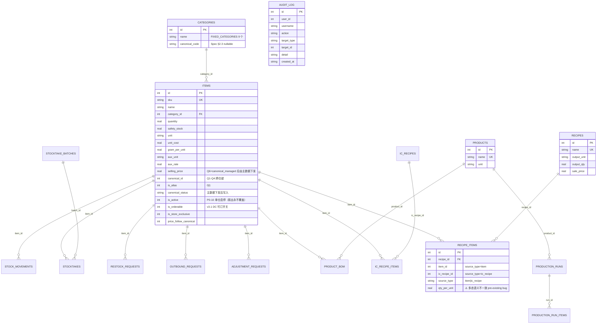

### 4.4 Schema 迁移约定（铁律）

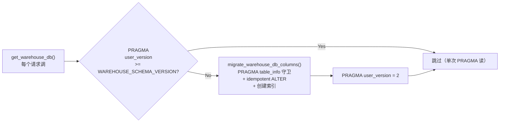

- **`WAREHOUSE_SCHEMA_VERSION = 2`**，改了 ALTER 块必须 bump。
- **新增 items 列只加到 `migrate_warehouse_db_columns()`，不加进 `WAREHOUSE_SCHEMA`**（tests 断言 WAREHOUSE_SCHEMA 不含 is_orderable）。
- **`init_master_db()`** 用 `fcntl.flock` 保护 gunicorn 多 worker 并发 ALTER。
- **所有绕过 `get_warehouse_db()` 直连 sqlite3 的代码（CLI / 测试 / MCP）必须先调 migrate**。
- **P0-6（2026-10-10 起）**：master.db 显式迁移走 `flask migrate status|up|down`（`migrations/__init__.py` 注册表 + `migrations_runner.py`，PRAGMA user_version 门控，每步前 sqlite3 backup API 热备到 `backups/migrations/`）。`init_master_db()` 幂等 ALTER 降级为兜底；**新 schema 变更一律加迁移条目**。回归 `tests/test_migration_runner.py`（9 用例）。

---

## 5. 应用层模块图

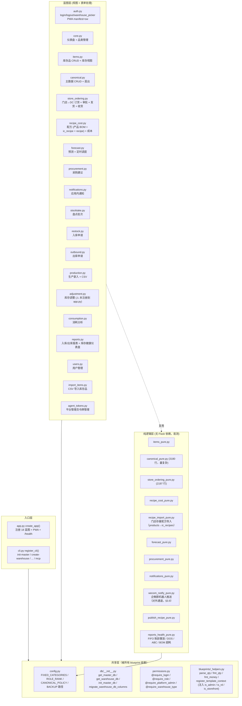

**约定**：`xxx.py`（蓝图，含 Flask 视图）和 `xxx_pure.py`（纯函数/类，便于测试和复用）成对出现。改业务规则时**优先改 pure**，再让蓝图调它。

**UI 导航结构（2026-10-13 导航模块化起）**：面向用户的信息架构收敛为 **7 模块** —
总览 / 库存管理 / 生产管理 / 门店订货 / 采购 / 通知 / 管理员，三个载体（桌面侧边栏 /
移动底栏 / `/land` 模块卡片）共用同一套模块归属与角色口径。归属决策与载体规则见
[`docs/2026-10-13-nav-modules.md`](2026-10-13-nav-modules.md)。

---

## 6. 蓝图依赖关系

```mermaid
flowchart LR
    classDef root fill:#fef3c7,stroke:#f59e0b,stroke-width:2px
    classDef pure fill:#dbeafe,stroke:#2563eb
    classDef bp fill:#e0e7ff,stroke:#4f46e5

    Shared["config / db / permissions<br/>(_helpers)"]:::root

    Auth[auth.py]:::bp --> Shared
    Auth -->|audit()| RecipeCost
    Items[items.py]:::bp --> Shared
    Items --> ItemsPure[items_pure.py]:::pure
    Canonical[canonical.py]:::bp --> Shared
    Canonical --> CanonicalPure[canonical_pure.py]:::pure
    StoreOrdering[store_ordering.py]:::bp --> Shared
    StoreOrdering --> StoreOrderingPure[store_ordering_pure.py]:::pure
    StoreOrdering --> WecomNotifyPure[wecom_notify_pure.py]:::pure
    StoreOrderingPure --> Procurement[procurement.py]:::bp
    StoreOrderingPure --> NotificationsPure[notifications_pure.py]:::pure
    StoreOrderingPure --> ProcurementPure[procurement_pure.py]:::pure
    RecipeCost[recipe_cost.py]:::bp --> Shared
    RecipeCost --> RecipeCostPure[recipe_cost_pure.py]:::pure
    RecipeCost --> RecipeImportPure[recipe_import_pure.py]:::pure
    RecipeCost --> PublishRecipePure[publish_recipe_pure.py]:::pure
    RecipeCost -->|audit()| Auth
    Forecast[forecast.py]:::bp --> Shared
    Forecast --> ForecastPure[forecast_pure.py]:::pure
    Procurement --> ProcurementPure
    Notifications[notifications.py]:::bp --> Shared
    Notifications --> NotificationsPure
    Users[users.py]:::bp --> Shared
    AgentTokens[agent_tokens.py]:::bp --> Shared
    Reports[reports.py]:::bp --> Shared
    Reports --> ReportsHealthPure[reports_health_pure.py]:::pure
    Reports -->|master.db 只读| StoreOrders["store_orders（门店履约）"]
    Others["stocktake/restock/outbound/production/<br/>adjustment/consumption/<br/>core/import_items"]:::bp --> Shared
```

**依赖原则**：
- 蓝图层可以调 **pure 层 + 其他蓝图层**（如 `recipe_cost` 调 `auth.audit()`）。
- **pure 层不依赖 Flask 上下文**（不 import flask），便于测试和跨场景复用。
- `store_ordering_pure` 是跨最多业务的纯模块（订货同时触发采购缓存重建 + 通知事件）。
- `wecom_notify_pure` 是**唯一对外通道**：只读 `config` + 标准库 `urllib`，不碰 DB、不碰 Flask 上下文；蓝图把订单字典传进去，它负责渲染 + POST。任何新事件接入都走 `WEBHOOK_EVENT_MAP`（§3.9），不要在蓝图里自己拼 HTTP 请求。

---

## 7. 请求生命周期

### 7.1 Web（Cookie 会话）

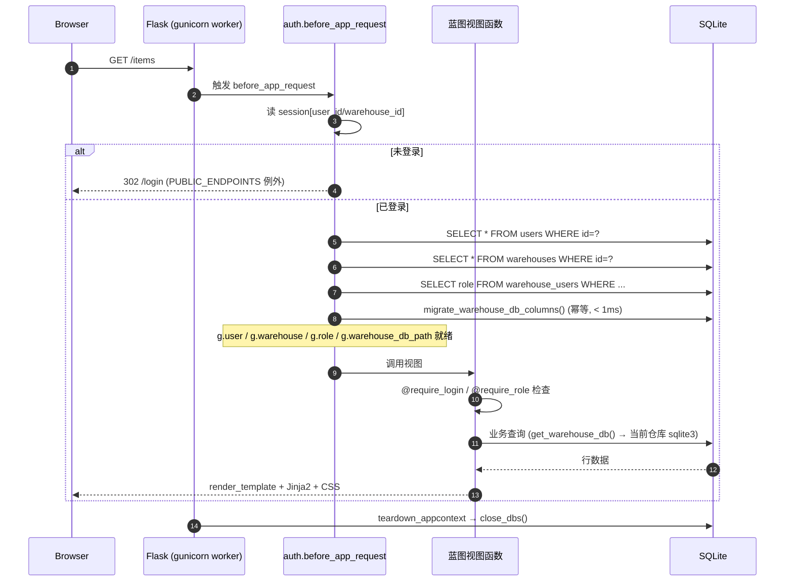

**AJAX 双路径契约**：`static/ajax-form.js` 给请求打 `X-Requested-With: fetch` + `Accept: application/json`。`register_ajax_handlers(app)` 注册的 after_request hook 检测到这两个头时，把视图的 3xx redirect 改写成 200 JSON 信封 `{ok, location, message}`，同时 drain Flask flash 进 `message`；非 AJAX 路径（浏览器整页 POST / curl / MCP）保留 302 redirect 字节级不变。详见 §13.7。

### 7.2 MCP（HTTP Bearer）

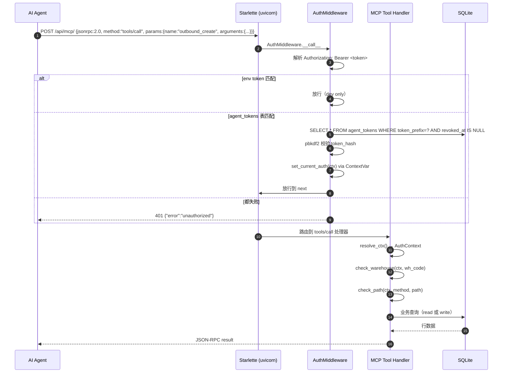

---

## 8. 鉴权架构

### 8.1 三种身份

| 身份 | 用途 | 凭证 | 鉴权位置 |
|------|------|------|----------|
| **Web 用户** | 浏览器访问 | Flask session cookie（HttpOnly + SameSite=Lax，prod Secure） | `auth.before_app_request` |
| **MCP Bearer** | AI Agent 通过 HTTP 调用 | `Authorization: Bearer <token>` | `mcp_server/main.py:AuthMiddleware` |
| **CLI** | `flask ...` 命令 | 无（进程级，信任部署环境） | 直接 sqlite3 |

### 8.2 装饰器

| 装饰器 | 文件 | 作用 |
|--------|------|------|
| `@require_login` | `permissions.py` | 必须登录 + 已选仓库（除非 view 在 `WAREHOUSE_EXEMPT`） |
| `@require_role(min_role)` | 同上 | 必须达 `min_role`（staff=1/manager=2/admin=3）；`is_admin` 平台管理员 bypass |
| `@require_platform_admin` | 同上 | 必须 `g.user.is_admin=1`（不绕过） |
| `@require_warehouse_type(*types)` | 同上 | 当前仓库类型必须在白名单（rd/storefront/dc） |
| `storefront_only` / `distribution_center_only` | 同上 | 上述的白名单语义糖 |
| `@require_permission(*codes)` | 同上 | **权限点（RBAC）**：当前用户须持有全部 codes（AND）；语义与 `require_role` 对齐（登录→超管 bypass→选仓→权限） |
| `@require_any_permission(*codes)` | 同上 | 任一 code 命中即放行（OR），用于「owner 或提权」场景 |

### 8.3 鉴权关键路径

```mermaid
flowchart TB
    Request[HTTP Request] --> Check{endpoint 在<br/>PUBLIC_ENDPOINTS?}
    Check -->|Yes| Skip[跳过鉴权]
    Check -->|No| HasUser{session 有 user_id?}
    HasUser -->|No| Login[302 → /login]
    HasUser -->|Yes| LoadUser[加载 g.user/warehouse/role]
    LoadUser --> Decorator{视图装饰器}
    Decorator -->|@require_login| NeedWh[需要 warehouse_db_path]
    Decorator -->|@require_role| RoleCheck{role 达 min_role?}
    Decorator -->|@require_platform_admin| AdminCheck{is_admin?}
    Decorator -->|@require_warehouse_type| TypeCheck{wh_type 匹配?}
    NeedWh --> RoleCheck
    RoleCheck -->|Yes| Execute[执行视图]
    RoleCheck -->|No| Flash403[flash + abort 403]
    AdminCheck --> TypeCheck
    TypeCheck --> Execute
```

**注意**：`@require_role` 和 `@require_platform_admin` 都允许 `is_admin=1` 通过。`@require_platform_admin` 反而**要求** `is_admin`，这是有意区分（前者"在这个仓库里权限够" vs 后者"全局管理权限"）。

### 8.6 租户隔离（P0-1 轻方案 PoC，2026-10-10 起）

- `master.db`：`tenants` 注册表 + `users/warehouses/canonical_items.tenant_id`（默认 1 = 存量单租户，老库 ALTER 自动回填）。
- 请求上下文：`g.tenant_id`（auth 钩子从 user 行取）。
- 三道闸：① 钩子加载仓库时校验 `warehouse.tenant_id == user.tenant_id`（`is_admin` 平台管理员豁免）② picker 只列本租户 ③ `/select-warehouse/<id>` 租户闸先行（跨租户脏绑定 → 403）。
- 新仓放置：租户 1 保持 `db/warehouses/`；租户 N 落 `db/tenants/<N>/warehouses/`（`flask create-warehouse --tenant N`）。
- **PoC 未覆盖（后续阶段）**：canonical 扇出/订单/MCP token/报表查询的租户化过滤；当前仅列/读仓与选择入口强制。回归 `tests/test_tenant_isolation.py`（8 用例）。
- **账号管理（v2 2026-10-12 起）补完**：`/users` 路由全套按 tenant 过滤 —— `list_users` 接受 `?tenant_id=`（admin 跨租户可指定，非 admin 强制 scope 到 `g.tenant_id`）。见 §8.7。

### 8.7 账号管理 v2（feat/user-admin-v2，2026-10-12 起）

- **页面重写**：Notion/Linear 风格 —— 顶部工具栏（搜索/角色/租户/启停/排序/新建）+ 紧凑表格（一行一用户，6 列）+ 右侧 360px 抽屉（编辑/创建/批量绑定/启停/删除）。`templates/users.html` 重写，`static/users-admin.css` + `static/users-admin.js` 新增（零依赖）。
- **schema**：`users.is_active INTEGER NOT NULL DEFAULT 1` + 复合索引 `idx_users_tenant_active (tenant_id, is_active)`。PRAGMA 守卫做幂等 ALTER（`db/__init__.py:init_master_db`）。
- **登录拦截**：`blueprints/auth.py:login` 在密码校验之前先查 `is_active=0`，命中返回 403 + flash「账号已停用，请联系平台管理员」。不进入失败计数（避免已停用账号仍触发锁定）。
- **新 endpoint**：
  - `POST /users/<id>/toggle-active`：切换 `is_active`（不能停用自己 —— 防锁出唯一 admin；可重新启用）。
  - `POST /users/bulk-bind`：body=`user_ids[] + warehouse_id + role`，`INSERT OR IGNORE` 保证幂等（已绑定的 (user, warehouse) 静默跳过），无 user 时 flash 报错。
- **list_users 查询参数**：`q`（≥2 字 LIKE）/ `role`（用户在任一仓库持有该角色）/ `tenant_id` / `is_active` / `sort`（白名单 id/username/last_login_at，可加 `-` 前缀降序）/ `page` / `page_size`（默认 20、上限 100）。`?format=json` 显式开启返回 JSON envelope（默认浏览器走 HTML）。**sort 白名单必须比对「剥离 `-` 之后」的列名**：先去掉前导 `-`（`sort[1:] if sort.startswith("-")`）再查集合，否则 `-last_login_at` 会落到 fallback `id` 且方向仍是 DESC（降序静默变 id 倒序）。
- **守卫统一**：移除 `blueprints/users.py:_require_admin()`，全 view 改用现成的 `@require_platform_admin` 装饰器（`permissions.py:54`）。`agent_tokens.py` 的同名内联守卫本次不动（独立 PR 范围）。
- **测试**：`tests/test_users_admin_v2.py`（40 用例）覆盖搜索/筛选/启停/批量绑定/租户过滤/守卫/停用登录拦截/分页/排序（升降序 + 白名单兜底）/创建权限矩阵默认值/`/users` 不可缓存（含 `sw.js` 缓存边界的静态断言）/schema 迁移幂等/既有 endpoint 回归。Spec：`docs/decisions/SPEC-user-admin-v2.md`。⚠️ 抽屉 JS（`users-admin.js`）无 pytest 覆盖：`escapeHtml`、radio 默认值、刷新时序、SW 缓存这类缺陷只能靠浏览器冒烟（Playwright + 本地实例：admin 登录 + 选仓后断言 URL 不含 `format=json`、每仓库恰 1 个 `:checked`、改库后同 URL 取到新值、离线导航落 `offline.html`）——后续应把冒烟脚本沉淀为自动化用例。
- **工具栏刷新机制（2026-10-13 修正）**：筛选/翻页走 `fetch(带筛选参数的 /users)` + `DOMParser`，只替换 `#users-tbody` 与 `.users-pagination`，`history.replaceState` 同步地址栏；表格/分页标记仍由 Jinja 渲染（JS 不重复实现行渲染，避免两套标记漂移）。三条硬约束：① **禁止 `window.location.assign` 到带 `?format=json` 的 URL**——那会把整个管理页换成裸 JSON（曾发生：点一下筛选/翻页页面就没了）；② 待替换的分页节点会被整块换掉，`click` 监听必须挂 `document`，插回时锚点用 `.users-table-wrap`（`tbody.insertAdjacentHTML` 落在 table 上下文会触发 foster parenting，分页条被塞进表格内部）；③ 只认最后一次请求（`refreshSeq` 序号），change 分支不 debounce，旧响应晚回来不得覆盖新结果。URL 参数以地址栏现有值为基底（`page_size` 等非工具栏字段得以保留），并强制 `delete('format')`。④ 页面内 `fetch` 的 HTML **必须不可缓存**：这正是当初踩到 SW cache-first 的原因，见 §11「SW 缓存边界」。两层各自的作用：HTTP/代理层靠 `Cache-Control: no-store`；SW 的 Cache API 层靠 `sw.js` 的「只缓存同源 `/static/`」范围判断（**no-store 对它无效**）。
- **抽屉 JS 约定（2026-10-13 修正）**：`static/users-admin.js` 用 `innerHTML` 拼抽屉内容，所有来自 DB 的字符串（用户名/仓库名/租户名）必须过 `escapeHtml()`——实体表必须是真实体（`'&': '&amp;'` 等），写成裸字符等于空转、构成存储型 HTML 注入。抽屉里的编辑目标 uid 必须由调用方把被点击的 `tr.users-row` **显式传给 `renderEditDrawer(row)`**（uid 在函数内从 `data-user-id` 取出），不要经 `drawerBody` 的 DOM 属性中转（那段 html 在属性写入之前就拼好，会拿到空的或上一个用户的 id → 批量绑定绑错人）。**同一 radio group 内只能有一处 `checked`**：浏览器取文档序靠后的那个，创建抽屉的权限矩阵曾因此把"不动矩阵直接创建"变成"给新账号授上每个仓库的 manager"（v1 默认是「无权限」，必须保持）。
- **明确不做**（v2 不引入）：自助改密（无"个人中心"页）、租户 CRUD（PoC 仅做了字段）、agent_tokens 页面重写、修改用户名、审计 UI（`admin_audit.log` 仍是 JSONL）。

### 8.4 CSRF 保护（2026-10-10 起）

- `app.py` 挂 `CSRFProtect`（Flask-WTF）；`_csrf_testing_gate` 在 `CSRFProtect` **之前**注册（Flask before_request 按 FIFO 执行），`TESTING=True` 时默认关闭 CSRF（存量测试零改动），专测设 `WTF_CSRF_FORCE_ENABLED=True` 打开。
- 所有 `method="post"` 表单均带 `{{ csrf_token() }}`（`scripts/add_csrf_tokens.py` 注入 + `--check` 校验，新增模板后跑一次）。
- MCP（`/api/mcp/`）在独立 Starlette 进程、Bearer 鉴权，不经 Flask CSRF。
- 回归：`tests/test_csrf.py`（7 用例）。

### 8.5 Rate limiting（P0-4，2026-10-10 起）

- **全局**：`app.py` 内存滑动窗口（`rate_limit_pure.SlidingWindowLimiter`），每 IP 600 次/分钟（env `DAILYCHECK_RATE_LIMIT_PER_MIN` 可调），`/health`/static 豁免；TESTING 默认关（`RATE_LIMIT_FORCE_ENABLED` 打开）；超限 429。gunicorn 多 worker 各自计数、重启清零（v1 约定，Redis 升级路径预留）。
- **登录锁定**：master.db `login_throttle` 表（跨 worker），(ip, username) 维度，15 分钟窗内连错 5 次 → 锁 30 分钟；成功登录清零。**时间一律 UTC naive**（`datetime.utcnow()`），与进程时区无关，规避生产 CST/UTC 坑。
- **MCP per-token 配额**：`agent_tokens.rate_limit` 列（NULL=`MCP_DEFAULT_RATE_LIMIT`=120/分钟），`AuthMiddleware` 内存滑动窗口按 token_id 限速，超限 429；单进程内共享、重启清零。
- 回归：`tests/test_rate_limit.py`（15 用例）。

### 8.7 权限点（RBAC）精细化管理（2026-10-13 起）

**模型**：角色 = **权限点集合**。25 个权限点目录（order 5 / stock 6 / item 6 / report 3 / admin 5）定义于 `permissions_manifest.py::PERMISSION_CATALOG`；5 个内置角色包（`ROLE_PACKAGES`）——阶梯包 `staff(10) ⊆ manager(17) ⊆ admin(18)`，旁支包 `viewer(3)` / `finance(4)`（`rank=NULL`，不参与阶梯）。**单一事实来源** `permissions_manifest.py` 被守卫 / 管理 UI / 测试四方共用（守卫用 `@require_permission`，测试用 `tests/test_route_permission_matrix.py` 校验覆盖与不变式）。

**解析（`permissions.py::current_permissions()`）**：每请求一次 JOIN 查 master.db（`warehouse_users → roles → role_permissions`），结果缓存到 `g.perm_set`——**禁进程级缓存**（gunicorn 多 worker 会各自漂移）；**fail-closed**：任何异常 → 空集 → 403 + 日志；`is_admin=1` 返回全目录哨兵（超管直通）。未知角色 code（JOIN 空集）→ 403。

**存储**（master.db，`init_master_db()` 幂等播种）：`permissions` / `roles` / `role_permissions` / `permission_routes`（Web 与 MCP 共用词汇表，Phase B 填充）/ `approval_policies`（Phase 3 扩展点，空表）。启动断言 `_verify_builtin_packages()`（空包 / 阶梯破坏 / 权限数契约 / 越界点 / 孤儿点）**告警不 raise**（防单点数据问题拒绝启动）。改包后须 `flask reseed-builtin-roles` 显式重播种（`INSERT OR IGNORE` 不更新已存在行）。

**成本脱敏 / 成本读访问**（服务端，`blueprints/cost_redaction_pure.py`）：报表导出 `export_consumption` / `export_summary` 对无 `report.cost.view` 者把成本列留空（列结构不变）；**配方成本读接口**（`recipe_cost` 5 个 CSV 导出 + `api_cost` + `overview` 总览页）挂 `report.cost.view`（staff/viewer 403）；`/summary`、`/inventory` 页**不脱敏**（Eric 终裁④，口径例外）。另 `users.html` 页脚已注明「仓管理(该仓全权，品项删除除外)」（对齐终裁②：`item.delete` 为平台级）。

**兼容层**：`require_role` 阶梯与权限点**并存**——本期未迁移的路由（canonical 管理、import_items、stocktake CSV、forecast 非 index、procurement、store_ordering DC list/ship、reports 营业额写）保持 `require_role`/`require_platform_admin`，语义零变化。回归：`tests/test_route_permission_matrix.py`（49 用例）+ `tests/test_master_db_migrate.py`（RBAC 7 用例）。设计见 `docs/2026-10-12-permission-spec.md` / `-architecture.md` / `-implementation-plan.md`。

**管理 UI（阶段 1）**：`users.list_users` 向 `templates/users.html` 注入 `role_options`（`[{code,label}]`，**来源 `permissions_manifest`，顺序 = `BUILTIN_ROLE_CODES`**（staff→manager→admin→viewer→finance），`label` 取自 `ROLE_META`）；模板的角色选项与标签**一律渲染 `role_options`**——模板不得硬编码角色名单/中文名。**绑定校验与展示同源**：`blueprints/users.py::VALID_ROLES = set(BUILTIN_ROLE_CODES)`（5 包，取代旧 `ROLE_RANK` 仅 3 阶梯包）——管理员可把用户绑定到旁支角色 `viewer`/`finance`；未知角色 code 由 `_parse_binding` 在绑定层先拒（与运行时 JOIN 空集 fail-closed 呼应）。角色标签样式见 `static/role-tags.css`（语义：实心=可写 / 描边=只读；`viewer` 虚线、`finance` teal 描边、平台管理员琥珀）。阶段 2 的 `/admin/permissions` 权限矩阵视图见 Spec §7。

---

## 9. MCP 架构

### 9.1 进程拓扑

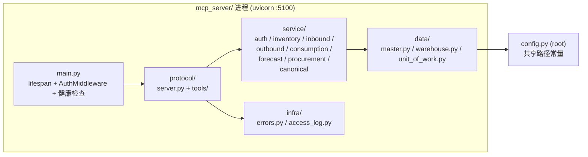

### 9.2 24 个 MCP 工具

| 工具 | 服务模块 | 路径 ACL | 仓库范围 |
|------|----------|----------|----------|
| `items_list` | inventory | read | per-token |
| `items_detail` | inventory | read | per-token |
| `movements_list` | inventory | read | per-token |
| `restock_create` | inbound | write | per-token |
| `restock_list` | inbound | read | per-token |
| `outbound_create` | outbound | write | per-token |
| `outbound_list` | outbound | read | per-token |
| `outbound_rollback` | outbound | write | per-token |
| `warehouse_consumption` | consumption | read | per-token |
| `item_consumption` | consumption | read | per-token |
| `item_forecast` | forecast | read | per-token |
| `procurement_store` | procurement | read | per-token |
| `procurement_hub` | procurement | read | per-token |
| `canonical_list` | canonical | read | 全局（跨仓） |
| `canonical_detail` | canonical | read | 全局（跨仓） |
| `canonical_categories` | canonical | read | 全局（跨仓） |
| `canonical_fanout_targets` | canonical | read | 全局（跨仓） |
| `canonical_conflicts` | canonical | read | 全局（跨仓） |
| `canonical_fanout_event` | canonical | read | 全局（跨仓） |
| `canonical_create` | canonical | write | 全局（跨仓） |
| `canonical_update` | canonical | write | 全局（跨仓） |
| `canonical_claim` | canonical | write | per-token |
| `canonical_unclaim` | canonical | write | per-token |
| `canonical_fanout` | canonical | write | 显式传 warehouse_codes |
| `canonical_resolve_conflict` | canonical | write | 全局（跨仓） |
| `canonical_set_binding_active` | canonical | write | per-token |

### 9.3 双传输模式

| 模式 | 入口 | 鉴权 | 用途 |
|------|------|------|------|
| **stdio** | `flask mcp` | 进程 env `DAILYCHECK_MCP_TOKEN` | 本地 Claude Code |
| **HTTP/SSE + StreamableHTTP** | `python -m mcp_server` (HTTP 模式) | Bearer → agent_tokens 表（per-token 仓库/路径 ACL） | 远程 Agent |

**HTTP 入口路径**：
- `/sse`（legacy SSE）
- `/messages/`（SSE POST）
- `/api/mcp/`（StreamableHTTP，**推荐**）
- `/health`（不需鉴权）

### 9.4 鉴权回退链

```mermaid
flowchart TB
    Req[HTTP Request with Bearer] --> Env{DAILYCHECK_MCP_TOKEN<br/>env 匹配?}
    Env -->|Yes| Pass1[放行（dev/兼容）]
    Env -->|No| Table[查 agent_tokens 表<br/>WHERE token_prefix=?<br/>AND revoked_at IS NULL]
    Table --> Found{找到 + pbkdf2 通过?}
    Found -->|Yes| SetCtx[set_current_auth(ctx)<br/>记录 ContextVar]
    Found -->|No| Legacy[查 NULL 前缀的历史行<br/>回退路径]
    Legacy --> Found
    Found -->|No| Deny[401 unauthorized]
    SetCtx --> Pass2[放行到工具处理器]
    Pass1 --> Pass2
    Pass2 --> Handler[工具 handler 用 resolve_ctx() 取 ctx]
    Handler --> ACL{check_warehouse +<br/>check_path 通过?}
    ACL -->|Yes| Exec[执行业务]
    ACL -->|No| Forbidden[403 ForbiddenError]
```

---

## 10. 业务领域模型

### 10.1 仓库类型

| 类型 | 用途 | 行为 |
|------|------|------|
| `storefront` | 门店（有实体库存） | 出入库/盘点/补货可见 |
| `rd` | 研发中心 | **无库存**；主数据管理；ic_recipe 编写 |
| `distribution_center` | 配送中心 | 给门店供货；store_ordering 审批/发货 |

### 10.2 Canonical 主数据治理（Q1-Q7）

| 策略 | 值（v4） | 含义 |
|------|----------|------|
| Q1 门店自建新主数据 | `deny` | 门店不能自建全新品项（白名单 = 空） |
| Q2 门店自治字段 | `open` | 允许门店自定义字段 |
| Q3 主数据删除 | `deactivate_only` | 只允许停用，禁止物理删除 |
| Q4 扇出冲突 | `freeze` | 冻结冲突字段，人工处理 |
| Q6 价格归属 | `canonical_managed` | 售价/采购价收归主数据 + 扇出下发 |
| Q7 库存零丢失 | `strict` | 扇出前自动备份；写库前 `shutil.copy2`；禁止真库写测试 |

> **Q7 `guard_real_db` 软链穿透防护（2026-10-15）**：prod 部署把 `db/warehouses/*.db` 做成指向 `/var/lib/dailycheck/warehouses/` 的软链，`resolve()` 会穿透使路径比较失配、guard 放行（verify.sh check1 在 prod 首演实测抓到）。guard 现对**未 resolve 的 absolute parent** 再比一次，任一命中即拒——改部署布局（换数据目录/软链形态）时必须保持此语义。

### 10.3 Store Ordering 状态机

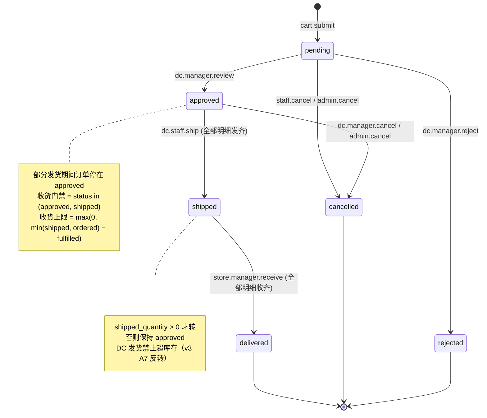

**通知**：每次状态迁移走 `store_ordering_pure.notify_order_event()` 向站内用户 fan-out（收件人按事件方向选 DC 审批人 / 门店用户，排除操作者自己）。**只有 `pending` 那一跳（`cart.submit`）额外推一条企微群消息**——见 §3.9；审批 / 发货 / 取消事件在 `WEBHOOK_EVENT_MAP` 里未登记，不对外推送。

### 10.4 Canonical 扇出流程

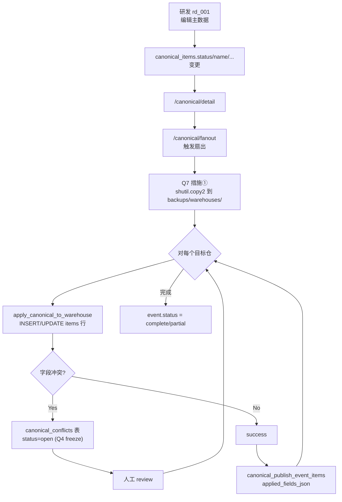

**两道闸门**（`fac7691` 定稿）：
1. **总闸** = `canonical_items.status='active'`（主数据侧）
2. **分闸** = 仓内 `items.is_orderable=1`（DC 单独控制可订）

主数据 disable 后**不自动扇出到仓内**（`is_active` 仍是 1）；仓内列表要等手动 `/canonical/fanout` 才生效。

**跨页跳转契约 — 筛选条件透传**（`feat/canonical-list-filter-preserve`，2026-10-12）：
- list → edit/detail：`url_for` 把当前 `q/category/status` 拼到 query string（URL 即状态、可分享）
- edit POST 成功：直跳带筛选的 list（不再过 detail），避免「保存→详情→后退」两步走
- edit POST 缺筛选字段：`referer` 同源 list URL 兜底（外部直链进 edit 时不丢上下文）
- detail 页头部「← 返回筛选结果」（有筛选时）/「← 返回品项列表」（无筛选时）
- 目的：用户在筛选结果里点编辑/查看 → 保存 → 直接回到原筛选上下文，不丢工作流

---

## 11. PWA / 移动端

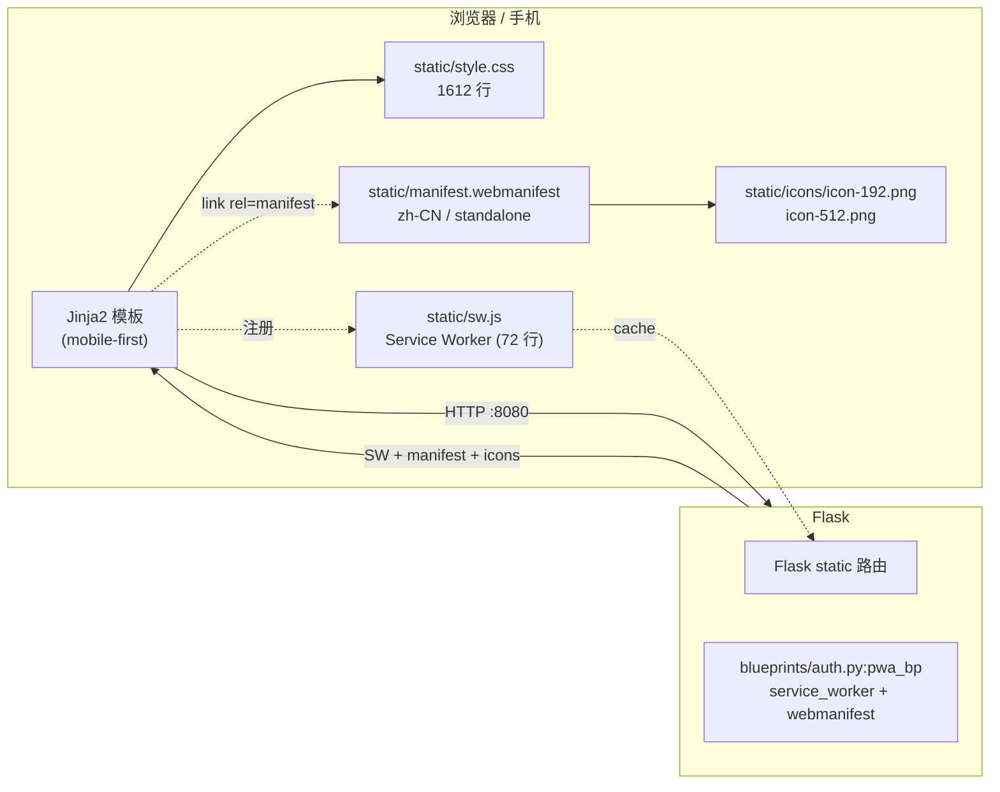

**现状**：
- ✅ Service Worker 离线缓存 + PWA install
- ✅ CSRF token 全表单覆盖（P0-3，2026-10-10）
- ✅ manifest.webmanifest（standalone、minimal-ui、theme_color teal）
- ❌ **无 push notifications**

**SW 缓存边界（2026-10-13 收窄，重要）**：`sw.js` 的 cache-first 分支**只对同源 `/static/` 生效**，其余非导航 GET（HTML 片段、JSON、接口）一律 network-only（不 respondWith，交给浏览器直连）。导航请求仍 network-first + 离线回落 app shell / `offline.html`。
- 反例（已实测复现，勿回退）：收窄前对所有非导航 GET 无差别 `cache-first` + `cache.put`。一旦页面内 `fetch` 一个 HTML 页面（`users-admin.js` 的工具栏就是这么刷 `/users?<筛选>` 的），该页面会被写进 Cache API，后果两条 —— ① 服务端数据变了列表仍返回旧副本且不报错；② 缓存副本按 URL 命中即返回、**不经过服务端鉴权**，匿名会话也能拿到 200 的管理员页面（响应自带的 `Vary: Cookie` 挡不住 Cache API 匹配，实测拿到含 `bulk01` 的完整页）。
- `/users` 的 HTML 与 `?format=json` 响应都带 `Cache-Control: no-store`（`blueprints/users.py:_no_store`）。⚠️ **no-store 只约束浏览器 HTTP 缓存与中间代理，对 Cache API 无效**——实测 `cache.put()` 照常落盘（MDN 的 `Cache.put` 异常清单里没有 no-store 规则）。所以**在这条「非导航 GET」路径上，唯一防线是上面那条范围判断**（`tests/test_users_admin_v2.py` 有字面量 + 顺序双断言钉住它）；no-store 只是 HTTP 层的附加收益，不要据此放宽范围判断。
  - 范围之外：sw.js 的**导航分支**仍有 `caches.match(req)` 离线回落，会把带会话的 SSR HTML 按 URL 命中返回而不经鉴权（APP_SHELL 存量问题，与本 PR 解耦另开 issue）。范围判断只解决非导航 GET 这条路。
  - 唯一例外：`_helpers.py` 的 AJAX 3xx 信封（`X-Requested-With: fetch` 时返回的 `{ok, location, message}`）是新响应对象、不带 no-store；它不含管理员数据，无可利用面，登记备查。
- **改 `/static/` 下的资源必须 bump 模板里的 `?v=`（或 bump `CACHE_NAME`）**：`/static/` 走 cache-first 且不回源，暖缓存客户端会永久拿到旧文件。
- 改 `sw.js` 的缓存策略记得 bump `CACHE_NAME`（当前 `dailycheck-v5`）：activate 时按名字清旧缓存，否则已中毒的缓存条目会一直活着。
- ❌ **无 background sync**（离线写不能排队）
- ❌ iOS Safari PWA 有已知限制（storage quota、push）

**导航三载体（2026-10-13 导航模块化）**：
- 桌面侧边栏（`base.html:aside.sidebar`）：7 个 `.nav-group` 模块分组（`nav-group-title` + 链接）；
  模块内无可见子项则整块不渲染；管理员模块置底。
- 移动底栏（`base.html:nav.mobile-nav`）：≤5 个高频模块入口 + 「更多」→ `/land`；
  flex 布局（角色不同条目数 3~5 动态），不再固定 5 列 grid。
- 模块索引页（`land.html`，`/land`，no_sidebar）：每模块一张 `section.land-card`，按角色过滤；
  **卡内 `ul.land-links` 必须列全该角色在该模块可见的每一个页面**（不是只链模块首屏）。
- ⚠️ **不变量（有测试固化）**：三载体的模块归属与角色口径逐条一致；
  `<961px` 时侧边栏 `display:none`，**「更多」→ `/land` 是移动端唯一全模块入口**，
  故 `/land` 一旦漏列二级页，该页在移动端即整页无路可达（v0.1 曾漏 汇总/盘点/入库/出库 4 页）。
  守卫用例：`tests/test_nav_integration.py`（模块集行列式 + 移动端可达性）。
- ⚠️ 角色口径一律取 `_helpers.register_template_context` 注入变量，禁止 block 内 ``（§13.2）。
- 改 `static/*` 后按约定 bump 模板里的 `?v=`（本次 `style.css?v=16` / `login.html?v=12`）。
- **总览模块单链接级角色门（2026-10-15 起）**：总览组内「库存健康」链接单独包
  ``——同一 nav-group 内
  按链接级可见性过滤的既有先例（同「门店订货」组内 `品项管理` 的写法），
  侧栏与 `/land` 两载体条件逐字一致，双向不变量由 `tests/test_reports_health.py::TestNavCarriers` 钉住。

---

## 12. 测试架构

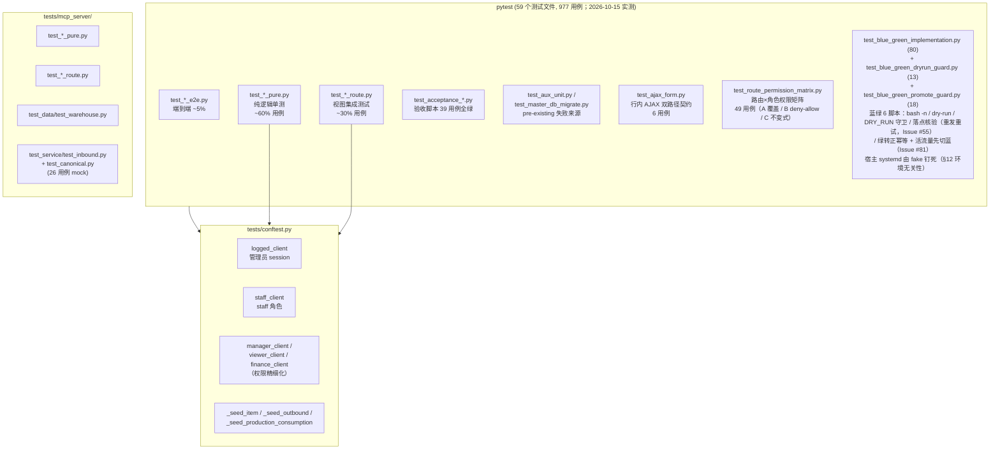

**运行**：
```bash
~/.local/bin/python3.12 -m pytest --basetemp=/tmp/pytest-dc   # 必须带 basetemp
```

**基线（2026-10-10）**：18 failed / 750 passed — 失败集与各次新开发严格逐行一致（owner SOP「零新增对比法」）。`feat/inline-form-ajax`（2026-10-11）新增 `test_ajax_form.py` 6 用例全过，零新增失败。`feat/user-admin-v2`（PR #17，2026-10-12）新增 `test_users_admin_v2.py` 40 用例，基线升至 **18 failed / 796 passed**，零新增失败。

**基线更新（2026-10-13，`feat/nav-modules`，rebase 至 `f00e490` 后）**：16 failed / 801 passed — `test_nav_integration.py` 旧断言（staff 应见采购）随导航模块化修正并扩充为 12 用例（796→801），失败集 18→16；`tests/known_failures.txt` 同步删 2 行（清单收缩为 16，与实际失败集逐条一致）。零新增。⚠️ 复用旧 basetemp（`/tmp/pytest-dc`）会因沙箱清理不完全随机出现 1~3 条 `sqlite3.OperationalError` ERROR；换全新 basetemp 即消失，与代码无关。

**整改基线（2026-10-14，`fix/pr-18-nav-modules-defects`）**：14 failed / 768 passed（CI 口径 `--ignore=tests/mcp_server`）。导航用例 12→57（`nav_client_factory` 角色矩阵 + 三载体链接集相等 + 全链接可达性 + 移动端可达性守卫），门禁 exit 0。

**权限精细化基线（2026-10-15，`feat/permission-granularity`，并流 main `9bb9d99` 后）**：14 failed / 928 passed（CI 口径；本地全量 16 failed / 1006 passed）。新增 `test_route_permission_matrix.py` 49 用例（A 覆盖 / B deny-allow / C 不变式）、`test_master_db_migrate.py` RBAC 迁移 +7 用例、`tests/conftest.py` 角色夹具（`manager_client` / `viewer_client` / `finance_client`）；并流后 `url_map` 实测 151 endpoint，Test A 双向断言无遗漏 / 无残留。失败集与 `known_failures.txt` 逐行一致，零新增，门禁 exit 0。

**外部通知基线（2026-10-16，`feat/store-order-wecom-notify`，基于 `1aa9cbc`）**：14 failed / 1156 passed（CI 口径 `pytest tests/ --ignore=tests/mcp_server`，`--basetemp=/tmp/pytest-dc`）。失败集与 `known_failures.txt` 逐行一致（14/16，`mcp_server` 两条在该口径下不收集），`scripts/check_known_failures.py` exit 0，零新增。新增 `test_wecom_notify_pure.py` 44 用例 + `test_wecom_notify_hook.py` 4 用例，全部 **monkeypatch `urllib.request.urlopen`、不透网**，夹具 webhook 为运行期拼接的假地址（不含真实 key）。

⚠️ **基线数字必须写明口径**（两套数字不能混用）：
- **CI 口径** = `pytest tests/ --ignore=tests/mcp_server`：**以本文件最近一条基线为准**（2026-10-16：14 failed / 1156 passed）。CI 以此为准，`known_failures.txt` 的 `mcp_server` 两行在 CI 里永不触发（属超集）。
- **本地全量** = `pytest tests/`（本地 python3.12 能跑 mcp 测试：2 failed / 78 passed）：失败数 = CI 口径 + 2（2026-10-15 实测 16 failed / 1006 passed；passed 数随新增用例变化，引用旧值须换算）。
- 「零新增对比法」比对的是**失败集逐行**，不是 passed 总数；引用总数时必须带口径，否则跨环境对比会误判。

**CI 门禁（2026-10-10 起，`.github/workflows/ci.yml`）**：
- ruff（仅改动 .py，pin 0.16.10）→ pytest 全量（`--ignore=tests/mcp_server`，容器门控）→ `scripts/check_known_failures.py` 零新增断言。
- `tests/known_failures.txt` = 已知失败清单，**只许收缩不许扩张**（修复一个删一行）。
- **防假绿（2026-10-11 起）**：门禁对 pytest 收集错误 / 空输出 / 0 passed 一律拒绝放行（收集错误不产生 FAILED 行，坏依赖曾致门禁空过假绿）。测试三方依赖（如 openpyxl）必须进 requirements.txt。
- `deploy` job `needs: test`：CI 不过不部署（PR 触发不部署）。
- **生产部署触发（2026-10-11 起）**：仅 `workflow_dispatch` 手动执行，push main **不**自动部署。启用自动部署的前置条件：VPS 安装备份 cron + 异地副本 + 一次真实部署演练。
- **`agent-framework-reports` 门禁（2026-10-15 起）**：`check_reports.py` 要求 PR body 含 h2「报告 1/4」「Checklist」「生产侧事项」三段且无未消解 ❌；CI 读事件时刻 body 快照，事后补 body 须推空 commit。

**测试的环境无关性（2026-10-15 起，Issue #44）**：用例结果不得取决于「在哪台机器上跑」。最脆的一维是**宿主 systemd**：`switch.sh` 的 DRY_RUN 守卫（PR #42）以 `systemctl show -p MainPID / -p Environment --value <unit>` 取证，于是 dev/CI（**无可用 systemd** —— dev 机没有 `systemctl` 命令；CI 镜像有该命令，但 systemd 未作 PID 1 致取证为空；两者都判「无法判定」→ 仅告警放行）与生产 VPS（`dailycheck-green.service` 固定 `Environment=DRY_RUN=true`，绿未「转正」→ 按设计 `exit 3` 拒跑）结论相反 —— 同一批 `test_blue_green_implementation.py` 用例在 prod 全红、在 dev/CI 全绿（Issue #44 现场 = 跑 `verify.sh` 时 check 1 报 5 个 fail）。**约定**：凡调用 `scripts/blue_green/*.sh` 的用例，必须把宿主 systemd 态**显式钉死**，不许默认「本机没有 systemctl」。`test_blue_green_implementation.py` 用模块级 autouse fixture `_fake_systemctl` 前置 fake `systemctl`（`Environment` 恒 `DRY_RUN=false` =「绿转正后的合法生产态」→ 守卫判 `not_dry_run` 放行），使用例回到「验证切流量动作本身」的原始意图；守卫自身行为由 `test_blue_green_dryrun_guard.py` 专项覆盖（该文件自建按 unit 注入 `Environment` 的 fake）。两处 fake 均只接管 `show`，其余子命令 `exit 0`，故 `journalctl` 等真命令缺失仍能让 `verify.sh` 的失败路径用例保持原语义。

**宿主态隔离的第二维与第三维（2026-10-17，Issue #81）**：除宿主 systemd，还有两维会让同一批蓝绿用例「dev/CI 绿、prod 红」，PR #59（部署单飞）上线后同时踩中：

- **② 部署单飞状态目录**（`DAILYCHECK_DEPLOY_STATE_DIR`，默认 `/var/lib/dailycheck-deploy`）—— `verify.sh` / `switch.sh` 的锁守卫只在目录**存在**时生效。生产上该目录已随单飞机制激活：无锁（`deploy_state.py check` rc 0）或锁属他 PR（rc 12）都会让**嵌套调用的** `verify.sh` 在 check 1 之前 `exit 10`（#81 现场是后者 —— pytest 里跑的是 `verify.sh 22/24`，锁属于正在部署的 PR #80 → rc 12），dev/CI 上该目录不存在 → 放行。于是 live 调 `verify.sh` 的用例（`test_verify_writes_report_on_fail` / `test_verify_continues_after_check_fail_and_writes_report`）在 prod 拿到的 rc 是 10 而非 1，且锁守卫在 `trap` 注册之前拒绝 → 报告也不生成。
- **③ 真实 nginx conf**（`NGINX_DAILYCHECK_CONF`）—— `switch.sh` 的布局守卫与 `cp`/`sed` 只在 conf **存在**时动作。prod 上默认路径真实存在，dev/CI 上不存在；继承宿主 conf 时 dry-run 用例的退出码就取决于那台机器的 conf 布局。

**修法（Issue #81 定稿）**：fake systemctl 抽到共享模块 `tests/blue_green_testenv.py`（`install_fake_systemctl()`），`test_blue_green_implementation.py` 与 `test_blue_green_deploy_lock.py` **共用同一份实现**（此前是两份副本漂移 —— 后者漏装 fixture 即 #81 的 3 个 fail 之一）；`test_blue_green_deploy_lock.py` 追加 `test_fake_systemctl_pins_not_dry_run` 自检，把「fake 真的接管 PATH 且判 `not_dry_run`」钉成事实断言（否则 fake 退化成 unknown 时 CI 依然全绿 —— dev/CI 本就没有 systemctl）。`verify.sh` live 用例统一走 `_hermetic_verify_env()`：状态目录指向不存在的 tmp 路径（= 机制未激活）、`DAILYCHECK_BG_LOCK_HELD=1`（不碰 `/var/lock`）、conf 指向不存在的 tmp 路径（布局守卫跳过 + `cp` 在 `set -e` 下立即失败 → **check 4 的回滚演练永远到不了 `systemctl reload nginx`**，绝不改写生产 conf / 切真实流量）、`BACKUP_DIR` 与 `DC_PYTHON` / `DAILYCHECK_APP_DIR` 全部落 tmp；「绿不可达」场景改由闭端口显式制造，不再依赖宿主 `:8091` 恰好没起。`test_blue_green_dryrun_guard.py` 的 live 用例同族补齐（autouse 钉状态目录 + 跳过 flock），否则生产上「无活跃锁」时 9 例 `exit 10` 全红、持锁时还会往生产 `audit.log` 追加审计行（测试写生产状态）。**新增调用 `scripts/blue_green/*.sh` 的用例必须沿用这两条约定**：否则下一次 `up.sh` 会被 verify check 1 的「零新增违例」拒启（fail-closed → 部署整体卡死）。

**同族新增**：`tests/test_blue_green_promote_guard.py` 在 `_base_env()` 里统一注入同一套隔离（状态目录指向不存在的 tmp 路径、`DAILYCHECK_BG_LOCK_HELD=1`、`SYSTEMCTL_BIN` / `CURL_BIN` / fake `ss` 全部落 fakebin），故 `promote.sh` 与 `up.sh` 的 live 用例在 dev / CI / prod 三处同解。

**Pre-existing 16 failed 分布**（2026-10-13 起）：
- `mcp_server×2 / aux_unit×2 / forecast_pure×8 / items_route×2 / procurement_route×1 / recipe_cost_route×1`
- （`nav_integration×2` 已于 2026-10-13 随导航模块化修复并移除）

---

## 13. 关键约定与坑

### 13.1 Schema 迁移

- ✅ 任何新列**只**加到 `migrate_warehouse_db_columns()`，**不**进 `WAREHOUSE_SCHEMA`（tests 断言）
- ✅ 改 ALTER 块必须 bump `WAREHOUSE_SCHEMA_VERSION`（当前 = 2）
- ✅ master.db 任何 schema 变更同步进 `init_master_db()`，否则 prod 首请求 `no such column`
- ✅ `init_master_db()` 用 `fcntl.flock` 保护 gunicorn 多 worker

### 13.2 Jinja2 陷阱

- ❌ **不要**在 `base.html` sidebar block 里 `` — block scope 不传子模板
- ✅ `is_admin` / `is_rd` / `is_storefront` 必须从 `blueprints/_helpers.py:register_template_context` 注入
- ✅ `current_tenant_id`（v2 账号管理）同样从 `register_template_context` 注入；缺失时回落 `None`，不要在模板里假设存在
- ✅ 仓库类型权威来源：`g.warehouse.warehouse_type`

### 13.3 时区不一致（**生产 bug**）

- **dev 容器 = UTC**（`/etc/timezone`）
- **prod 进程 = CST+8**（unit 未设 TZ）
- `datetime.now()` = 进程时区；`datetime('now')` SQL = UTC
- **时间类 bug 在 dev 不可复现、生产必现**

### 13.4 数量精度

- 所有数量用 `Decimal` + 2dp 量化（`_helpers.parse_qty` / `fmt_qty`）
- float 会被 `0.1+0.2=0.30000000000000004` 污染

### 13.5 主数据铁律

- `canonical_pure.NEVER_TOUCH_COLUMNS` 列出扇出永不覆盖的字段（仓内 `is_active` / `is_orderable` 等）
- `fanout` 必须先备份（`backups/warehouses/{code}-{tag}.db`）

### 13.6 dev 副本验证套路

```python
# 1. 复制 db
shutil.copytree('/opt/dailycheck/db', tmp/'db')
# 2. 在 import app 之前覆盖路径（auth.py 用 from config import BASE_DIR 在导入期绑定）
import config, db
config.BASE_DIR = tmp; config.MASTER_DB = tmp/'db/master.db'
config.WAREHOUSE_DB_DIR = tmp/'db/warehouses'
db.MASTER_DB = config.MASTER_DB; db.WAREHOUSE_DB_DIR = config.WAREHOUSE_DB_DIR
# 3. import app 并设 session
from app import create_app
app = create_app()
with app.test_client() as c, c.session_transaction() as s:
    s['user_id'] = ...; s['warehouse_id'] = ...
# 4. 测试
# 5. shutil.rmtree(tmp)
```

⚠️ **坑**：手动 `Cookie: session=<签名串>` 在 `test_client` 里**不被识别**，必须用 `session_transaction()`。

### 13.7 AJAX 双路径契约（2026-10-11 起）

`static/ajax-form.js` + `register_ajax_handlers(app)` 联合实现"行内小动作不再整页重画"。

**约定**：
- 视图函数**不感知** AJAX / 非 AJAX 差异，依旧 `redirect(url) + flash(msg)`（PRG 模式不变）。
- 客户端 marker：`X-Requested-With: fetch`（主） OR `Accept: application/json`（forward-compat）—— 任一即可。
- 服务端 after_request hook 仅在 3xx 命中时改写；4xx / 5xx 原样透传（让 `fetch().ok=false` 走 alert 失败分支）。
- ⚠️ **坑**：after_request hook **必须返回 Response 对象**，不能返回 `(jsonify(...), 200)` tuple。Flask 后处理 `response.vary.add("Cookie")` 对 tuple AttributeError。

**模板侧**：
- 行内 form 加 `data-ajax`；删除/回退类给行 `<tr>` / `<div>` 加 `data-row`，点完该行消失。
- toggle 类（启用停用、角色保存、标记已读）显式 `data-ajax-mode="reload-stay"` —— reload 但用 sessionStorage 缓存 scrollY + pageshow 还原，**不能**用默认 remove（会把状态文字一起删）。
- `onsubmit="return confirm(...)"` 在 ajax 路径下失效，必须迁移到 `data-ajax-confirm`。

**非 AJAX 路径**（curl / Python 测试 / MCP / 浏览器整页 POST）—— 302 redirect 字节级不变。

### 13.8 时间戳解析（**生产 500 来源**，Issue #38）

- **生产存量存在无秒形态**：2026-10-15 全 6 仓 + master 普查，只有 `wh_000.db` 的 `stock_movements.created_at` 与 `restock_requests.created_at` 各有 **54 行** 是 16 字符 `YYYY-MM-DD HH:MM`（跨度 2025-11-28 → 2026-10-13，**仍在产生**）。应用层所有写入点都走 `_helpers.now()` 的 19 字符格式，故来源是人工 / ops SQL。
- **读侧一律用 `reports_health_pure.parse_event_ts()`**，禁止裸 `datetime.strptime(ts, "%Y-%m-%d %H:%M:%S")`——严格匹配撞上无秒数据即 `ValueError` → `/report/health` 500（`replay_item_layers` 与 `compute_stocktake_quality` 两个站点都会炸）。
- **未知形态必须响亮失败**：`parse_event_ts` 抛 `ValueError` 且消息带原始值（原始值进 traceback 是本次事故能在 prod 一眼定位的原因）。**不许在调用点大面积 `try/except` 吞掉**——FIFO 账龄重放依赖每条流水的时间，静默跳过一条事件会把呆滞金额算错（错得无声无息，比 500 更难发现）。
- **唯一豁免：聚类型指标**。均值 / 占比类（如 `compute_fulfillment` 的平均履约周期）丢一个样本只让分母变小，**不会**像 FIFO 重放那样让整体结果错位，故允许 `except ValueError: continue`——但**必须留 WARNING 日志**（`logger.warning` 带原始异常消息），保持「不静默丢数据」这条线。
- **混排形态下 SQL 侧字典序比较在分钟粒度内非严格时序**：`created_at >= ?` / `>= recent_start`（`reports_health_pure.py` 的窗口过滤）是**字符串**比较，16 字符值在同一分钟内字典序排在 19 字符值之前。影响仅限 cutoff 前后 1 分钟内的行被不对称算入，量级可忽略，但别据此做严格时序推断。
- **不用 `datetime.fromisoformat` 兜底**：3.11+ 它会接受带时区偏移的字符串并返回 aware datetime，与调用方的 naive `now` 相减会 `TypeError`。本模块的时间语义是「本地 naive 字符串字典序」，不引入 aware 值。

### 13.9 DRY_RUN 拦截日志级别（2026-10-15 起，Issue #41）

- `db/dryrun.py` 的写拦截日志必须是 **WARNING** 级、带 `[dry_run] BLOCKED` 可检索前缀（`tests/test_dryrun_middleware.py` 有断言，降级即红）
- 原因：app 不设 `logging.basicConfig`（只有 `mcp_server/main.py` 设 INFO）→ 生产 root logger 默认阈值 WARNING，**INFO 级拦截日志被静默吞掉**——2026-10-15 事故取证时被吞写清单只能靠实例 access log 反推
- 约束：新增任何「必须留痕」的运维事件日志照此办理（WARNING + 可检索前缀），**不得**降级为 INFO/DEBUG

### 13.10 外部通道的开关与密钥（2026-10-16 起，§3.9）

- **env-only，不入仓库**：`WECOM_STORE_ORDER_WEBHOOK`（群机器人地址，含 `key=` = 密钥）与 `PUBLIC_BASE_URL`（消息链接域名）都由部署侧注入 `/etc/dailycheck/app.env`。仓库内缺省值为空串 / `https://kjtang.cn`，**任何真实 webhook 都不得出现在代码、测试夹具、文档、日志里**（同 §3.5 的 `WEBHOOK_SECRET` 口径）。
- **空值 = 功能关闭，不是错误**：`webhook_for_event()` 返回空串时静默 return。dev / CI 没有该 env 是常态，若在缺配置时抛错或刷 WARNING，会把「未启用」误报成故障。
- **日志只落脱敏 URL + errcode**：所有对外通道日志经 `mask_webhook_url()`，保留 host + path、查询串打码成 `key=***`。失败日志前缀可检索：`wecom_notify_attempt_failed` / `wecom_notify_dropped` / `wecom_notify_failed` / `wecom_notify_error`。
- **成功/失败均 WARNING，保证生产可观测**：`wecom_notify_ok` 与 `wecom_notify_failed` 同为 WARNING（同 §13.9 的成因——app 不设 `logging.basicConfig`，生产 root 阈值 WARNING，INFO 级被静默吞掉）。推送成功是「消息已出网」的运维事实，事后要能证明发过，因此不允许降级为 INFO；`tests/test_wecom_notify_pure.py::test_notify_ok_logged_at_warning` 钉住级别。
- **畸形 URL 必须就地降级，不得冒泡**：`urllib.request.Request()` 在**构造期**对缺 scheme / scheme 拼错 / 被引号包住的地址抛 `ValueError("unknown url type: '<完整 URL>'")`，异常文本即 `key=` 明文。它若冒出 `_post_once()`，会一路冒到 `_send_safely()` 的 `exc_info=True` → traceback 把密钥打进日志。因此 `Request` 构造必须与 `urlopen` 同在 `try` 内，`reason` 只放异常类型名（`unexpected=ValueError`）或数字码，**禁止拼接 URL 片段**；`send_webhook_markdown()` 对任何输入只返回 `bool`。回归用例覆盖「缺 scheme / scheme 拼错 / 带引号 / ftp」四形态，断言 `caplog.text` 不含密钥（2026-10-17 补，QA 阻断项）。
- **`PUBLIC_BASE_URL` 为空时消息里不带链接**：`build_order_url()` 在 base 为空时返回空串（不退回相对路径 `/store-ordering/orders/{id}`——群里点不开、只会误导），由 `build_store_order_markdown()` 整行省略。
- **`PUBLIC_BASE_URL` 必须是公网域名**：消息里的「查看单据」是给人点的，`127.0.0.1` / 内网地址在群里点不开；改部署布局（域名迁移）时同步改 env。
- **提交点接线必须有路由级用例**：`tests/test_wecom_notify_hook.py` 直接调悬挂挂钩函数，覆盖不到「视图里那一行有没有被删」；`tests/test_wecom_notify_route_wiring.py` 从 HTTP 入口断言「恰好调用 1 次 / 独立连接可见订单（commit 先于通知）/ 被拦提交不推送 / 通知异常不下沉」，删除 `submit_order_route` 中的 `_notify_wecom_new_order(order)` 即实战红（2026-10-17 补，QA 阻断项）。

- **开关粒度**：v1 是「一个事件一个 webhook」。要做多群 / 多事件时在 `WEBHOOK_EVENT_MAP` 登记新的 config 属性，不要在视图里写 `if 群A ... else 群B`。

---

## 14. pre-existing 风险清单

| 风险 | 严重度 | 状态 | 处理 |
|------|--------|------|------|
| 16 failed 测试（本地全量口径，2026-10-13 起） | 中 | pre-existing | 商业化前必须归零 |
| 时区不一致 | **高** | pre-existing | 多租户改造前必修 |
| 配方成本 qty 语义不一致 | **高** | **已修复（2026-10-16，`feat/recipe-rd-upgrade`）** | ic_recipe 引用行 qty 统一为**克**（`_save_recipe` output_qty 累计 / pure 成本层 / 前端 JS / BOM CSV 四处对齐，旧「份」语义废弃）。两库 recipes 表均 0 行，无存量迁移。详见 `docs/2026-10-16-recipe-rd-upgrade.md` §D1 |
| 全仓 11 处 `strptime(..., "%Y-%m-%d %H:%M:%S")` 严格匹配 | 中 | pre-existing（2026-10-15 登记，Issue #38 同源） | `app.py:171` / `blueprints/consumption.py:27,67` / `blueprints/forecast.py:80,100` / `blueprints/procurement.py:185` / `rate_limit_pure.py:89,109` / `mcp_server/data/warehouse.py:265,316,676`（另有 `blueprints/store_ordering.py:91` 是 `%Y-%m-%d` 纯日期形态，同类不同款）。**当前无生产数据触发**（2026-10-15 普查显示它们读的 `outbound_requests` / `production_runs` / `rate_limit` 等列全为 19 字符），故 Issue #38 只收敛了 `reports_health_pure` 的 4 个调用点 / 3 个代码站点（`replay_item_layers`、`compute_stocktake_quality`、`compute_fulfillment`）；行号按 2026-10-15 `52516a8` 校准，改动这些模块时按符号名而非行号定位。后续改动这些模块的时间解析时按 §13.8 同一 helper 语义处理 |
| **绿环境以 `DRY_RUN=true` 承载真实流量 → 写操作被静默丢弃** | **高（已实际发生）** | 事故已止血；**根治已交付待 merge**（Issue #41 → PR #42） | prod nginx 已 `blue down / green weight=100`（自 ~16:53 起），而 `dailycheck-green.service` 声明 `Environment=DRY_RUN=true` → `DryRunConnection` 把 INSERT/UPDATE/DELETE 全部拦截 + 不 commit，用户侧仍收到 302 成功。**已确认丢失**：2026-10-15 18:11:35/37/43 三次 `POST /production/submit`（product_id=15）全部 302 但真库零落库。**结构性成因**：§3.4 的切流量流程没有任何一步清掉绿环境的 `DRY_RUN`。**处置**：生产侧已 `switch.sh blue 100` 止血（运行态 blue 100 / green down）；**根治**= §3.4 铁律新增的 `switch.sh` DRY_RUN 守卫（承接流量且 `DRY_RUN=true` → 拒跑 exit 3），已随 Issue #41 修复交付（PR #42）。⚠️ **下一次切流量前必须先按 `scripts/blue_green/README.md`「绿转正」关闭绿的写隔离**，否则会被守卫拒跑（预期行为） |
| `adjustment.py` 未注册 | 低 | pre-existing | 路由 404，前向兼容保留 |
| `fix/mcp-streamable-http` 落后主分支 | **高** | pre-existing | prod 不含本轮任何 P0 收敛 |
| `mcp-server` 进程 prod 未部署 | 中 | pre-existing | 仅 dev 有 |
| 导航是「隐藏式」而非「强制式」权限 | 中 | pre-existing（2026-10-14 登记） | 多处「路由权限 ≠ 导航可见性」：`/canonical/list` 仅 `@require_login`（任何登录角色可直连，导航只给 admin/rd）；`/store-ordering/{admin/orders,admin_report,shipping-rules}` 为 `@require_role("admin")`（仓库角色）而导航 gate 是平台 `is_admin`（单仓 `role=admin` 可直连但不显示）；对称地 DC 用户实际可访问 `/inventory` 但导航不展示。需在权限颗粒度项目中按统一权限模型收敛 |
| 侧边栏 `<h1>` 与模块标题同名 | 低 | pre-existing（2026-10-14 登记） | `base.html` 侧栏 `<h1>库存管理</h1>` 与「库存管理」模块标题重复；文案由 owner 定 |
| `/production*` 页无侧栏 | 低 | pre-existing（2026-10-14 登记） | `templates/production/{products,runs,product_edit,session}.html` 把 `sidebar` block 覆盖为空 → 桌面端在这些页没有导航（只能靠返回/页内链接）。本次新增的「生产记录」入口沿用同布局。移动端不受影响（`mobile-nav` 未被覆盖） |
| PWA push / background sync 缺失 | 中 | pre-existing | 商业化差异化卖点 |
| 企微推送无重发队列 / 无失败告警 | 低 | 已知限制（2026-10-16 登记，§3.9） | 对外通道失败只留 WARNING（`wecom_notify_dropped` + errcode），不阻塞下单、不回滚、不补发；机器人被移出群 / key 轮换后需人工更新 `/etc/dailycheck/app.env` 才恢复。通知 SLA 属商业化项，另立项 |
| `sw.js` 导航分支的离线回落缓存不过鉴权 | 中 | pre-existing | `caches.match(req)` 会把安装时用会话凭据抓的 SSR HTML 按 URL 命中返回（缓存在同 profile 的离线/共享设备场景可读到他人页面）。与 §11「SW 缓存边界」的收窄范围无关（那条只覆盖非导航 GET），待另开 issue |

---

## 15. 文档索引

### 必读

- [`CLAUDE.md`](../CLAUDE.md) — 项目权威文档（dev 环境、目录、提交规范）
- [`AGENT.md`](../AGENT.md) — 精简开发指南
- [`docs/DEV_ENV.md`](DEV_ENV.md) — wdg-systemd 容器部署细节
- [`docs/mcp-configuration.md`](mcp-configuration.md) — MCP 接入
- [`docs/agent-framework/workflow.md`](agent-framework/workflow.md) — Dev/Prod/Owner 三方协作工作流（角色、门禁、merge 政策、蓝绿部署、应急）

### 部署 / 运维

- [`scripts/blue_green/README.md`](../scripts/blue_green/README.md) — 蓝绿部署操作手册（6 脚本用法 / 验证矩阵 / **「绿转正」标准步骤**，2026-10-15 事故后增补）

### 业务领域

- [`docs/2026-10-09-item-master-unify-plan.md`](2026-10-09-item-master-unify-plan.md) — canonical 主数据统一（P0-1~13）
- [`docs/2026-10-03-canonical-item-design.md`](2026-10-03-canonical-item-design.md) — 主数据原始设计
- [`docs/2026-10-03-canonical-item-prd.md`](2026-10-03-canonical-item-prd.md) — 主数据 PRD
- `docs/2026-10-04-store-ordering-*` — 订货流程 5 篇文档 + 4 张 mermaid
- `docs/2026-10-05-store-ordering-*` — v2/v3 迭代

### UI / 导航

- [`docs/2026-10-13-nav-modules.md`](2026-10-13-nav-modules.md) — 导航模块化 7 模块 IA（归属决策 + 三载体规则）

### 评估 / 计划

- [`docs/2026-10-10-commercialization-gap-assessment.md`](2026-10-10-commercialization-gap-assessment.md) — 商业化差距评估
- [`docs/2026-10-10-commercialization-p0-dev-test-plan.md`](2026-10-10-commercialization-p0-dev-test-plan.md) — P0 收敛开发/测试计划
- [`docs/runbook-dr.md`](runbook-dr.md) — 灾难恢复手册（备份/还原/整机重建）

### 集成

- `docs/integrations/dailycheck-mcp/` — MCP 接入文档 + examples

### 工作记忆

- [`.workbuddy/memory/MEMORY.md`](../.workbuddy/memory/MEMORY.md) — 跨 session 项目约定
- `.workbuddy/memory/YYYY-MM-DD.md` — 每日工作日志
- [issue-reports/](../issue-reports/) — 自动生成的 issue 检查报告（55 份）

---

## 附：维护本文件的工作流

每次 commit 触及下列子系统时，**必须**同步更新对应章节：

| 触及文件 | 须更新章节 |
|----------|-----------|
| `app.py` / `config.py` / `permissions.py` | §2 §3 §8 |
| `db/*.py` | §4 |
| `blueprints/auth.py` | §7 §8 |
| `blueprints/items*.py` | §5 §6 §10 |
| `blueprints/canonical*.py` | §5 §6 §10.2 §10.4 |
| `blueprints/store_ordering*.py` | §5 §6 §10.3 |
| `blueprints/recipe_cost*.py` | §5 §6 |
| `blueprints/forecast*.py` / `procurement*.py` / `notifications*.py` | §5 §6 |
| `blueprints/production.py` / `stocktake.py` / `restock.py` / `outbound.py` / `adjustment.py` / `consumption.py` / `reports.py` | §5 §6 |
| `blueprints/users.py` / `import_items.py` / `agent_tokens.py` | §5 §6 §8 |
| `mcp_server/*.py` | §9 |
| `templates/**` | §5 §11 |
| `static/**` | §11 |
| `tests/**` | §12 |
| `.github/workflows/*` / `deploy/**` / `scripts/**` | §3 §12 §附 |
| `docs/ARCHITECTURE.md`（本文件） | 自更新 |

**门禁脚本**：`scripts/git-hooks/pre-commit` 已装。运行 `python scripts/arch_touched_sections.py` 看本 commit 该改哪些章节。
