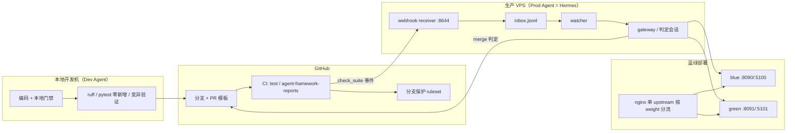
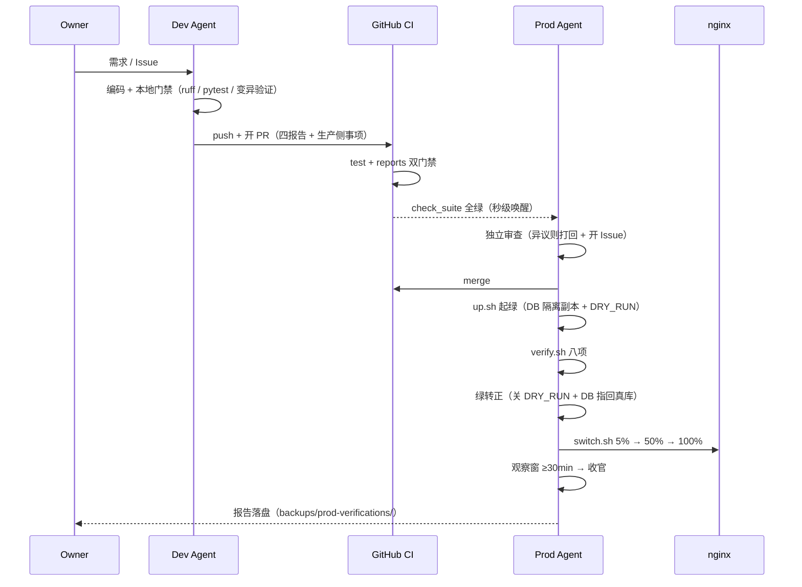

# 自治开发流水线白皮书

> **一句话**：这不是「让 AI 帮我写代码」，而是**把一套治理结构编码进仓库**——让"谁来判断它写对了"这个问题，由机器、门禁和角色边界来回答，而不是由人盯着看。
>
> 实证对象：DailyCheck（Flask + SQLite + systemd + nginx 蓝绿，单人维护的商业系统）。
> 周期：2026-10-13 起草 → 2026-10-17 全链闭环（5 天）。
> 规模：432 次提交 / 54 个 PR（45 个合并）/ 39 个 Issue / 62 个测试文件 / 1429 条通过用例。
>
> 本文写给三类人：想复刻这套机制的工程师、要评估它是否可信的管理者、以及下一个接手项目的 Agent。

---

## 1. 问题：自动化写代码不是瓶颈，「验收」才是

2026 年的现实是：让 AI 写出一段能跑的代码已经不难。难的是三件事：

| 难点 | 表现 |
|------|------|
| **判断对错** | 代码能跑通 ≠ 业务正确；AI 自己说"已完成"没有证据价值 |
| **判断影响面** | 改一行 `permissions.py` 可能让某个角色丢权限，写代码的人未必知道 |
| **持续可信** | 第一次对了，第 50 次还对吗？人会累，Agent 不会累但会幻觉 |

传统答案是「人 review」。但 review 有两个硬约束：**人的注意力是线性成本**，以及**人不在场时流程就停摆**。

所以真正的命题不是"如何让 AI 写更多代码"，而是：

> **如何让"合不合、能不能上"这个判断，在没有人盯着的时候仍然成立。**

---

## 2. 核心命题与三条设计原则

DailyCheck Agent 自治框架 v0.1 的原始表述（`docs/agent-framework/v0.1.md`）：

> 以**契约化验收** + **多层自动测试** + **报告比对**替代人工 review，逐步实现 Agent 自治免盯。

落到工程上，是三条原则：

### 原则一：契约化验收 —— 让"完成"有机器可判定的定义

"完成"不能是 Agent 的主观声明，必须是可执行的断言：

- 需求 → R 表（每条需求一行，状态只能是「已消解」）
- 契约 → 测试 / schema diff / 报告
- **报告全绿 ≡ review 通过**

### 原则二：角色分离 —— 谁承担风险，谁做决定

| 角色 | 载体 | 职责 | 绝不碰 |
|------|------|------|--------|
| **Dev Agent** | 本地开发机 | 编码、测试、提 PR、修 CI、同步文档 | merge、生产环境 |
| **Prod Agent** | VPS 常驻 | **merge 判定**、部署、验证、切流、回滚 | 写业务代码、改契约 |
| **Owner** | 人 | 红线内政策拍板、需求拍板 | 日常 PR 审查 |

关键设计：**merge 权交给生产端**。理由是——合不合，应该由最终承担生产风险的一方决定；而质量权威仍然是 CI 门禁，owner 只做红线兜底。

这不是"权力随便分"，而是**把三种不同的失败模式交给最敏感的一方**：

- Dev 对"代码能不能跑"最敏感 → 交给它本地门禁
- CI 对"有没有回归"最敏感 → 交给它自动化
- Prod 对"上生产会不会炸"最敏感 → 交给它 merge 判定
- Owner 对"这是不是我们要的东西"最敏感 → 只在这里介入

### 原则三：一切权威都在仓库文件里，不在聊天记录里

Agent 会换 session、会失忆。所以**权威口径必须落盘**：

- `docs/agent-framework/workflow.md` — 角色/流程/门禁/红线（最高口径）
- `docs/ARCHITECTURE.md` — 架构铁律
- `tests/known_failures.txt` — 失败基线
- `.workbuddy/memory/MEMORY.md` + 每日日志 — 跨 session 上下文

提示词只做**指针**，不复制内容。这条原则的价值在换会话时立刻显现：新 session 读三个文件就能接上，不需要人重新解释一遍。

---

## 3. 架构总览

### 3.1 组件拓扑



### 3.2 端到端时序



### 3.3 三道闸

| 闸 | 位置 | 拦什么 | 失败代价 |
|----|------|--------|---------|
| **第一道：本地** | Dev 机器 | 语法、lint、回归、假绿 | 几分钟返工 |
| **第二道：CI** | GitHub | 全量回归、报告完整性、密钥泄漏 | 一次 push |
| **第三道：生产验证** | VPS 绿环境 | 真实数据下的行为、性能、回滚能力 | 一次部署（不影响蓝） |

三道闸的分工原则：**越靠前的闸越便宜，越靠后的闸越真实**。能在本地拦住的绝不留给 CI，能在 CI 拦住的绝不带病上绿环境。

---

## 4. 演进路径：五天，五次纠错

这套机制不是一次设计出来的，是被事故打出来的。按时间线：

### 阶段 0（10-13）：v0.1 设计稿 —— 一个基于"想象"的方案

Eric 拍板起骨架，当天产出角色分工、测试金字塔、四报告模板、蓝绿脚本骨架。

**同一天就被推翻了一半。** Prod Agent 在 VPS 实测后反馈，v0.1 里有三个**凭想象写下的错误假设**：

| 错误假设 | 真相 |
|---|---|
| "Mac mini Docker 与生产同构" | VPS 根本没有 docker 蓝绿基建，是 systemd |
| "SQLite 有独立只读副本" | SQLite 多文件没有副本概念 |
| "verify.sh 先 `exit 0` 占位，形同空跑" | 这比拒绝执行更危险——会让人以为跑过了 |

原文档里留了一句自我批评，值得原样引用：

> **根因**：我在 Mac mini 本地凭想象写脚本，没在 VPS 实测。**这正是 Prod Agent 这种"先看实际再说话"角色的价值**——本框架设计时缺这道闸。

> → **教训一：设计稿必须被"会承担后果的那一方"实测校正。**

### 阶段 1（10-14）：CI 门禁落地

`test` job（全量 pytest + 零新增失败）与 `agent-framework-reports` job（四报告齐全性）上线，分支保护强制。

### 阶段 2（10-15）：工作流定稿 + 第一次真实事故

- 三方协作口径定稿（`workflow.md`），PR 模板四段强制
- merge 政策**一天内改版两次**：早先定"Dev 自行 merge + 红线上报"，当晚改为"Prod 判定 merge"——因为意识到**风险承担者与决策者必须同一**
- 红线清单确立（改 CI / 改分支保护 / 扩失败基线 / 改工作流本身 → 必须 owner 拍板）

同一天 `Issue #32`：nginx 切流量导致 **30 分钟 502**。根因是 4 个切换脚本只改 upstream 的 `weight`，却不动 `location` 的 `proxy_pass`。修复引入「单 upstream 布局 + 布局守卫 + 切后探活」三道防线。

> → **教训二：部署脚本的"看起来生效"比"报错"危险得多。**

### 阶段 3（10-16）：从"轮询"到"事件驱动"

- 部署 PR webhook 接收器 + `inbox.jsonl` 订阅器，Prod Agent 从"定时轮询"变成"事件唤醒"
- 接 GitHub `check_suite` 事件：**CI 全绿后秒级唤醒**（实测绿→merge 54 秒）
- 保留 30 分钟兜底轮询，防事件丢失

> → **教训三：事件驱动降低延迟，但必须保留兜底轮询——事件会丢，轮询不会。**

### 阶段 4（10-17）：部署链路闭环 + 架构事实层

- **部署单飞锁**：同一时刻只允许一个部署会话，杜绝并发部署打架
- **部署链路脚本化**：`promote.sh`（绿转正幂等）、`up.sh` 活流量守卫（绿在承流时先切蓝再重启）
- **架构事实层**：派生式架构图 + CI 强校验，解决文档漂移

> → **教训四：自动化越深，"并发"和"幂等"这两件事越致命。**

### 演进形状总结

```
v0.1 设计（想象）  →  Prod 实测打回  →  v0.2（事实驱动）
                                      ↓
                              三道闸 + 角色边界
                                      ↓
                     事故驱动：502 / 审批死锁 / DRY_RUN 事故
                                      ↓
                    事件驱动 + 单飞锁 + 派生文档
```

**每一版都不是"加功能"，而是"补上上一版被证伪的地方"。**

---

## 5. 关键机制详解

### 5.1 零新增失败基线（最便宜也最有效的一招）

`tests/known_failures.txt` 维护一份"已存在的失败"清单，规则三条：

1. 只许收缩，不许扩张
2. 修好一个就删一行
3. CI 判据是**集合包含**，不是"全绿"

为什么这招重要：**绝大多数存量项目不可能一次做到全绿**。如果门禁要求"全绿"，项目永远上不了自动化；如果要求"不更差"，今天就能开始。

> 这条设计让"引入自动化"的门槛从"先还清所有技术债"降到"别欠新债"。

### 5.2 四报告契约（PR 必须自证）

PR body 强制四段：报告 1/4（需求对齐 R 表）、Checklist、生产侧事项、风险与回滚。CI 用脚本扫描：

- 缺 h2 段落 → 红
- R 表里还有未消解占位 → 红
- 「报告 1/4」之后出现字面红叉字符 → 红

**设计要点：门禁读的是 PR body，不是代码。** 这让"Agent 有没有说清楚自己在干什么"变成可检查项。

### 5.3 生产侧事项的写法铁律（防"盲区传染"）

Dev 只写**规范流程粒度**（变更类别、影响子系统、观察窗重点），**不写逐条操作脚本**。

理由原文：

> Prod Agent 的价值在于**用自己的视角独立发现问题**；照抄 Dev 的脚本会让 Dev 的盲区变成双方的盲区。

> 这条是整个设计里最反直觉、也最精妙的一处：**故意不传递信息，是为了保住第二个视角。**

### 5.4 蓝绿部署 + DRY_RUN 写隔离

```
up.sh     起绿（DB cp -aL 独立副本 + DRY_RUN=true）
   ↓
verify.sh 八项（pytest / 五路径 / 性能 / 回滚演练 / 资源 / dry_run 证据 / DB 隔离 inode / 入口探活）
   ↓
绿转正    关 DRY_RUN + DB 指回真库 + restart（顺序不可颠倒）
   ↓
switch.sh 5% → 50% → 100%，每档观察；异常 rollback.sh 秒回蓝
```

`DRY_RUN=true` 是核心安全设计：绿环境能看到真实数据，但**所有写操作被拦截并留痕**。

### 5.5 唤醒链（Prod Agent 怎么"知道有事发生"）

```
GitHub check_suite 全绿
   ↓ (webhook，带 HMAC 签名)
webhook receiver :8644
   ↓
inbox.jsonl（append-only 文件队列）
   ↓ (inotify 变体，≤5s)
watcher → gateway 会话
   ↓
Prod Agent 判定
```

三层保障：**快通道**（check_suite，秒级）+ **事件队列**（inbox，防丢）+ **兜底轮询**（30 分钟，防全链故障）。

### 5.6 红线清单（把"不能自动决定"写死）

以下必须 owner 拍板，Agent 不得自行处理：

1. 扩张 `tests/known_failures.txt`
2. 改 `.github/workflows/*`
3. 改分支保护 / ruleset
4. 删 `ARCHITECTURE.md` 铁律段
5. 改工作流文档自身 / merge 政策（防角色自我扩权）
6. `--force` push / 删远程分支
7. owner 标注「需拍板」的变更

> 第 5 条是精髓：**规则本身也在红线内，防止 Agent 通过改规则来扩权。**

### 5.7 架构事实层（派生文档，禁止手改）

手写架构文档的宿命是漂移。实测：近 30 天 93 个"触及架构面"的提交里，只有 41 个同步了文档（44%）。

解法不是"要求写得更勤"，而是**让事实由代码派生**：

- `scripts/arch_map.py` 从源码生成 `docs/ARCHITECTURE_MAP.md`（路由 × 鉴权、表、蓝图装配、MCP 域）
- `tests/test_arch_map.py` 断言"提交版 == 当前源码派生结果"，**不一致 CI 就红**
- 副产品：这个文件的 `git diff` 就是**机器可读的架构变更日志**

> 派生图管「是什么」，手写文档管「为什么」。前者的正确性由机器保证，后者由人保证。

### 5.8 跨 session 记忆

四层：

| 层 | 载体 | 作用 |
|---|---|---|
| 1 | `CLAUDE.md` 头部「先读」 | 新 session 自动发现权威口径 |
| 2 | `session-bootstrap.md` | 旧 session 升级提示词（用一次即弃） |
| 3 | Agent 常驻指令 | 角色行为约束 |
| 4 | `.workbuddy/memory/` 每日日志 + 蒸馏记忆 | 兜底上下文 |

阈值化管理：当日日志 append-only；长期记忆限 3000 字符，写满就**蒸馏**（合并重复、压缩句式、把细节改成指针）。

---

## 6. 事故簿：机制是被什么打出来的

这一节比前面所有内容都重要。**可信度不来自"我设计得多好"，而来自"我知道它会怎么坏"。**

| # | 事故 | 根因 | 补的机制 |
|---|------|------|---------|
| 1 | **nginx 切流量 30 分钟 502** | 切换脚本只改 upstream weight，`location` 硬编码指向旧 upstream | 单 upstream 布局 + 布局守卫（旧布局直接拒跑）+ 切后探活 + verify 终态检查 |
| 2 | **绿环境以 DRY_RUN 接流量（两次同型）** | 绿转正步骤漏做，写操作被静默拦截，HTTP 200 假成功 | `promote.sh` 幂等脚本 + `up.sh` 三步复位静息态 + 三层 fail-closed 断言 |
| 3 | **`up.sh` 在绿承流时把它重启成 DRY_RUN** | 脚本默认假设"绿是空闲的" | 活流量守卫：绿在役 → 先探活蓝 → 先切蓝再重启 |
| 4 | **webhook 会话危险命令审批死锁** | `/approve` 按"发起会话"解析，而无头会话没有聊天窗口可回复 | 跨会话 fallback：自身会话无待审批时，解析其它会话最老的待审批 |
| 5 | **`execute_code` 绕过审批门** | 审批门只装在 `terminal` 工具上，脚本内 `subprocess` 不过门 | 评估后**明确不做技术收口**，改为政策侧纪律管理（见下） |
| 6 | **架构文档 44% 漂移** | pre-commit 只保证"有文档 diff"，不保证内容正确 | 派生图 + 测试强校验 |
| 7 | **并发部署互相踩**（锁被误清） | 无单飞限制；人工 `clear-lock` 会清掉别人正在用的锁 | 部署单飞状态目录 + 会话心跳 + `clear-lock` 前必查 `status` |

### 关于第 5 条，值得单独说

`execute_code` 的旁路是**设计边界**：它是 `local` 环境下的裸子进程，没有 OS 级隔离，"沙箱"只是临时目录 + 工具白名单。

三个可选方向的代价：

| 方向 | 做法 | 代价 |
|---|---|---|
| 技术 | 给 `execute_code` 接门禁 | 裸 `subprocess` 在解释器内部，纯扫描不可靠；要做就得 OS 级隔离 |
| 部署 | 收窄无人值守 profile 的工具集 | 失去脚本化能力 |
| 政策 | 维持现状，靠纪律 | 依赖 agent 不主动滥用 |

**owner 拍板：维持现状。** 这是一个诚实的取舍，不是遗漏——**知道哪里不设防，比假装处处设防更重要。**

---

## 7. 度量

| 指标 | 数值 |
|---|---|
| 从设计稿到全链闭环 | 5 天（10-13 → 10-17） |
| 提交 / PR / Issue | 432 / 54（合并 45）/ 39 |
| 测试文件 / 通过用例 | 62 / 1429 |
| 既有失败基线 | 16 条（只许收缩） |
| CI 门禁 | 2 个必需 check（回归 + 报告） |
| 架构事实 | 165 条路由 × 鉴权 / 59 张表 / 19 个蓝图 / 7 个 MCP 工具域 |
| Prod Agent 唤醒延迟 | 秒级（check_suite 快通道），兜底 30 分钟 |
| 部署回滚 | 秒级切回蓝（`rollback.sh`） |
| 生产验证 | 8 项（`verify.sh`，约 12–14 分钟） |

**一个含蓄的指标**：最近几轮 PR 从"CI 全绿"到"合并完成"，人工介入次数为 0。

---

## 8. 移植清单：哪些能直接抄

### 8.1 与项目无关，可直接复制（80% 价值在这）

1. **零新增失败基线** —— 任何有存量技术债的项目，今天就能用
2. **四报告契约 + PR body 门禁** —— 把"说清楚"变成可检查项
3. **角色分离 + 红线清单** —— 尤其是"merge 权归生产端"和"改规则本身也要拍板"
4. **生产侧事项只写流程粒度** —— 保住第二个视角
5. **派生文档 + 测试强校验** —— 任何"文档一定会烂"的场景都适用
6. **事件驱动 + 兜底轮询** 双保险

### 8.2 需要按环境改造（20%）

| 机制 | 依赖 |
|---|---|
| 蓝绿 + DRY_RUN 写隔离 | 需要能起第二套实例、DB 可复制 |
| 单 upstream 灰度 | 需要 nginx / LB 支持 weight |
| webhook + inbox 唤醒链 | 需要常驻 Agent + 可收 webhook |
| 部署单飞锁 | 需要文件系统锁 + 会话可标识 |

### 8.3 最小可行起步（一天内）

```
1. 建 known_failures.txt，跑一次全量测试，把当前失败灌进去
2. CI 加一个 job：失败集 ⊆ 清单，否则红
3. PR 模板加四段，写个 20 行脚本扫段落齐全性
4. 定三条红线：改 CI / 改保护规则 / 扩基线 → 必须人拍板
```

这四步不需要蓝绿、不需要 Agent 常驻，**但已经能挡住 80% 的低级失误**。

---

## 9. 边界：什么情况下这套东西不成立

诚实地说，它有明确的前提：

| 前提 | 不满足会怎样 |
|---|---|
| **有足够测试覆盖** | 门禁再严也只是"没变差"，不保证"对" |
| **需求可被拆成可验收条目** | "做得好看一点"无法契约化，只能人看 |
| **生产风险可隔离**（蓝绿/灰度） | 每次部署都是全量赌博，自动化等于放大风险 |
| **有人守红线** | 红线清单会退化成形式，Agent 会试探边界 |
| **单团队、单仓库** | 跨仓/跨团队的契约变更，当前机制覆盖不到 |

最后一条尤其重要：这套设计解决的是**"一个人 + 几个 Agent 维护一个系统"**的问题。它不解决组织协作、不解决合规审计、不解决多方决策。

---

## 10. 结语：这套东西真正在做什么

如果只记一句话，我希望是这句：

> **它不是让 Agent 更聪明，而是让"不聪明也能安全交付"成为可能。**

三个具体体现：

1. **把判断标准从"我觉得对"变成"断言通过"** —— 让 Agent 的自信失去意义
2. **把风险决策交给承担风险的人** —— 让角色边界替代人的持续在场
3. **把规则本身也放进笼子** —— 防止系统在演进中自我扩权

这套机制跑通之后，owner 的角色从"审代码的人"变成了"定边界的人"。这不是把人排除出去，而是**把人的注意力从"每一行"挪到"每一条规则"**——后者才是真正稀缺的资源。

---

## 附：相关文件

| 文件 | 内容 |
|---|---|
| `docs/agent-framework/workflow.md` | 三方协作权威口径（角色/流程/门禁/红线） |
| `docs/agent-framework/v0.1.md` | 框架设计稿 v0.1→v0.2（含三次自我批评） |
| `docs/agent-framework/case-studies/2026-10-15-self-contained-dev-loop.md` | Issue #32 完整案例（2 小时 7 分闭环） |
| `docs/agent-framework/session-bootstrap.md` | 跨 session 接入提示词 |
| `docs/ARCHITECTURE_MAP.md` | 架构事实图（机器生成） |
| `docs/ARCHITECTURE.md` | 架构铁律与「为什么」 |

---

*本文基于 DailyCheck 仓库 2026-05-01 ~ 2026-10-17 的实际提交、Issue、事故记录与记忆日志整理，非事后构想。文中所有数字均可复现。*
